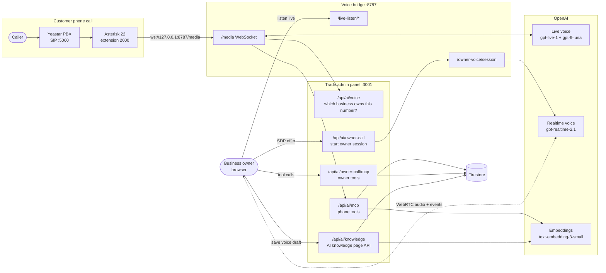
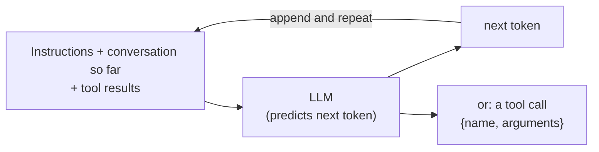
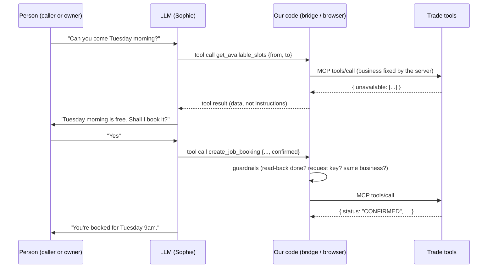
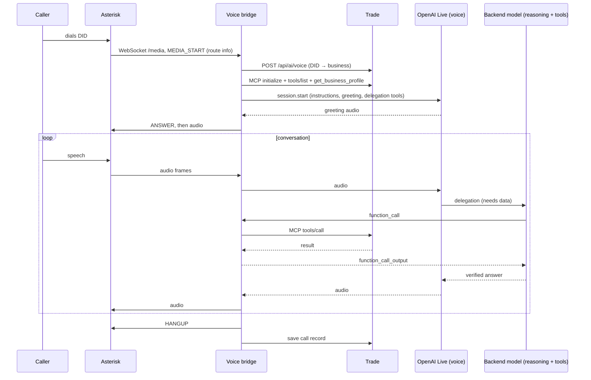
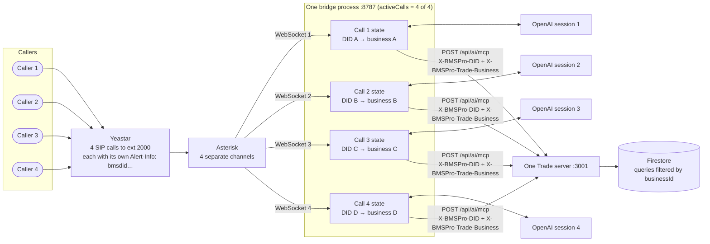
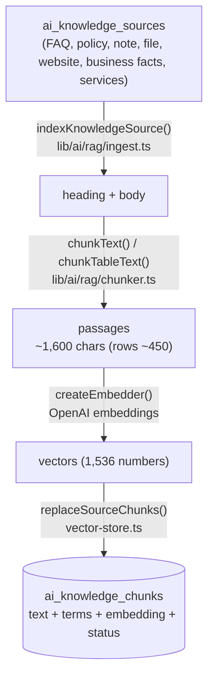
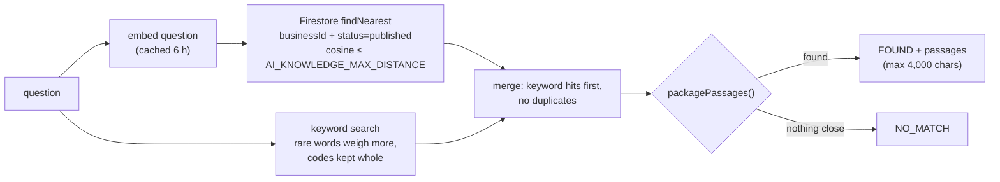
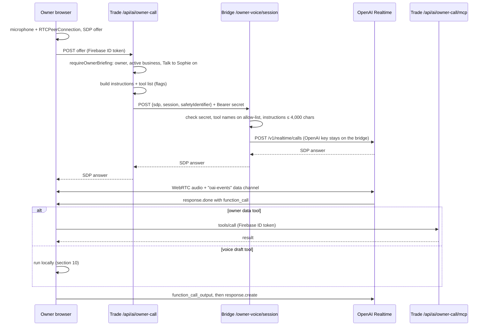
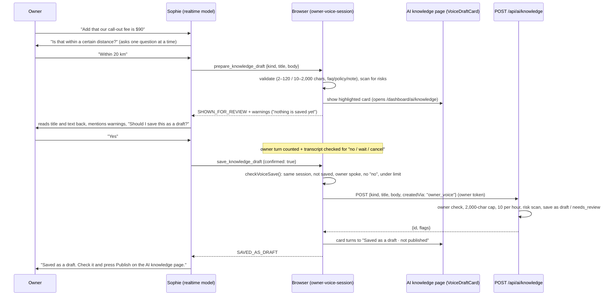

# Sophie AI agent: how the whole system works

This guide explains, end to end, how Sophie works in BMS Pro Trade:

- **Phone Sophie** answers customer calls.
- **Talk to Sophie** is the voice assistant for the business owner in the admin panel.
- **Tools (MCP)** let Sophie read and change business data safely.
- **AI knowledge (RAG)** lets Sophie answer from the business's own documents.
- **Voice knowledge drafts** (new) let the owner add notes to the knowledge base by talking.
- **Live transcript** (new) shows the conversation as text while the owner talks to Sophie.

It also covers the ideas underneath: what an LLM is, what "agentic AI" means, and the guardrails that keep Sophie safe. Every port, route, file and setting is listed.

Last updated 13 November 2026. Related documents:

- [owner-voice-knowledge-plan.md](owner-voice-knowledge-plan.md): plan for owner Sophie's knowledge search.
- [RAG_HOW_IT_WORKS.md](RAG_HOW_IT_WORKS.md): RAG in more depth.
- [trade-direct-voice-bridge.md](trade-direct-voice-bridge.md): the Trade connection on the bridge side.
- In the voice-bridge repo: `docs/commands.md` (laptop setup) and `docs/FUNCTIONS_AND_FLOW.md` (every bridge function).

---

## Contents

1. [The big picture](#1-the-big-picture)
2. [Machines and ports](#2-machines-and-ports)
3. [How an LLM works (plain English)](#3-how-an-llm-works-plain-english)
4. [What "agentic AI" means here](#4-what-agentic-ai-means-here)
5. [Phone Sophie: answering a call](#5-phone-sophie-answering-a-call)
6. [MCP: how Sophie uses tools](#6-mcp-how-sophie-uses-tools)
7. [RAG: how Sophie knows your business](#7-rag-how-sophie-knows-your-business)
8. [Talk to Sophie (owner voice)](#8-talk-to-sophie-owner-voice)
9. [Live transcript (new)](#9-live-transcript-new)
10. [Voice knowledge drafts (new)](#10-voice-knowledge-drafts-new)
11. [Guardrails: all the safety layers](#11-guardrails-all-the-safety-layers)
12. [Settings and feature flags](#12-settings-and-feature-flags)
13. [Running it locally](#13-running-it-locally)
14. [Troubleshooting](#14-troubleshooting)
15. [File map](#15-file-map)
16. [Glossary](#16-glossary)

---

## 1. The big picture

There are three projects and two cloud services:

| Part | What it is | Where |
|---|---|---|
| **Trade admin panel** | Next.js app. Business data, the MCP tool server, AI knowledge, call logs, Talk to Sophie | This repo |
| **Voice bridge** | Node.js server. Joins phone audio to OpenAI and runs Sophie's tools during a call. Also starts owner voice sessions | `bmspro-voice-bridge` repo |
| **Asterisk** | Phone software on the Melbourne server. Receives calls from Yeastar and streams the audio to the bridge | Server `aicallcenter` |
| **OpenAI** | The AI models: live voice, backend reasoning, owner realtime voice, transcription and embeddings | Cloud |
| **Firestore** | Database: businesses, jobs, knowledge, call logs | Firebase project `bmspro-trade` |



**Summary:**

- On a **phone call**, the bridge sits in the middle: the audio goes caller → Asterisk → bridge → OpenAI, and the tools go bridge → Trade.
- In **Talk to Sophie**, the bridge is only used to *start* the session, because the OpenAI key lives on the bridge. After that, the owner's browser talks to OpenAI directly over WebRTC and runs the tools itself, against Trade.

---

## 2. Machines and ports

### 2.1 Ports

| Port | Machine | Who listens | Who connects | Notes |
|---|---|---|---|---|
| `5060` (SIP) | Yeastar cloud | Yeastar | Asterisk | Asterisk registers as extension 2000 |
| `8787` | Server `127.0.0.1` | The bridge, **or** the SSH tunnel to a laptop bridge | Asterisk (`/media`) | `BMSPRO_PORT`, `BMSPRO_BIND_HOST`. Only one of the two can hold it |
| `8787` | Laptop `127.0.0.1` | Laptop bridge (`node --env-file=.env --env-file=.env.trade-direct-pilot bridge.mjs`) | SSH tunnel, Trade (owner voice and live listen) | `/media`, `/health`, `/owner-voice/session`, `/live-listen/calls`, `/live-listen/audio` |
| `3001` | Laptop | Trade (`npm run dev` runs `next dev --port 3001`) | Bridge (`BMSPRO_TRADE_MCP_URL`), browser | `/api/ai/mcp`, `/api/ai/voice`, the dashboard |
| `13001` | Server `127.0.0.1` | SSH reverse tunnel → laptop `3001` | Server bridge | Only when the bridge runs **on the server** and Trade runs on the laptop |
| `18787` | Laptop `127.0.0.1` | SSH local tunnel → server `8787` | Trade (owner voice, live listen) | Only when Trade on the laptop uses the **server's** bridge |
| `22` | Server (Tailscale `100.88.220.83`) | sshd | Laptop | Carries the tunnels |
| `3900` | Server (optional) | VoiceStudio speech-to-text | Bridge | Only with `BMSPRO_VOICESTUDIO_SHADOW_ENABLED=true` |

### 2.2 The two local setups

**Setup A: bridge on the laptop (the usual one, `docs/commands.md`)**

```
Caller → Yeastar → Asterisk (server) → server 127.0.0.1:8787
            ── ssh -R 127.0.0.1:8787:127.0.0.1:8787 ──► laptop bridge :8787
                                                         ├─► OpenAI
                                                         └─► Trade :3001 (laptop)
Owner browser → Trade :3001 → laptop bridge :8787 (AI_OWNER_VOICE_BRIDGE_URL=http://127.0.0.1:8787)
```

**Setup B: bridge on the server, Trade on the laptop**

```
Caller → Yeastar → Asterisk → server bridge :8787 → server 127.0.0.1:13001
            ── ssh -R 127.0.0.1:13001:127.0.0.1:3001 ──► Trade :3001 (laptop)
Owner browser → Trade :3001 → laptop 127.0.0.1:18787
            ── ssh -L 127.0.0.1:18787:127.0.0.1:8787 ──► server bridge :8787
```

> **`-R` or `-L`?** `-R` (reverse) means "the server listens and sends it to my laptop". `-L` (local) means "my laptop listens and sends it to the server". If `ssh -L ...:18787` says `channel 1: open failed: connect failed: Connection refused`, nothing is running on the server's 8787. You are in setup A, so use the laptop bridge on 8787 instead.

### 2.3 How one port carries many calls

A port is like the **door number of a building**, not a single phone line. The bridge opens port 8787 **once**, and every call comes in as a **new connection** through that same door.

The operating system tells connections apart by four values: source address, source port, destination address and destination port. Asterisk uses a new random source port for every call, so four calls look like this:

```
call 1   127.0.0.1:51234  ──►  127.0.0.1:8787/media   (WebSocket 1)
call 2   127.0.0.1:51240  ──►  127.0.0.1:8787/media   (WebSocket 2)
call 3   127.0.0.1:51255  ──►  127.0.0.1:8787/media   (WebSocket 3)
call 4   127.0.0.1:51261  ──►  127.0.0.1:8787/media   (WebSocket 4)
```

**Through the SSH tunnel (setup A):** there is still only **one** SSH connection on port 22. Inside it, SSH opens a separate **channel** for each forwarded connection, so 4 calls means 4 channels in 1 SSH connection. The `channel 1: open failed` message refers to these channels. If the SSH connection drops, **all** channels inside it drop, and with them every call.

**Going out from the bridge:**

- Each call opens its **own** secure WebSocket to OpenAI (`wss://`, port 443).
- Requests to Trade are short HTTP requests (port 3001, or 13001 in setup B). They are not kept open: Trade's MCP route is *stateless*, and a `GET` for a long-lived stream returns `405`.

### 2.4 Every connection in a call

| # | Connection | From → to | Protocol and port | How many | How long |
|---|---|---|---|---|---|
| 1 | Phone line | Caller → Yeastar | Phone network | 1 per call | The call |
| 2 | SIP + audio | Yeastar → Asterisk | SIP (`5060`) for signalling, RTP (UDP) for audio | 1 SIP dialog + 1 RTP stream per call | The call |
| 3 | Call audio to the bridge | Asterisk → bridge | WebSocket `ws://127.0.0.1:8787/media`, subprotocol `media` (`connection_type=per_call_config`, so a new socket per call) | 1 per call | The call |
| 3a | Tunnel (setup A only) | Server `8787` → laptop `8787` | One SSH channel inside the SSH connection on `22` | 1 channel per call | The call |
| 4 | Which business? | Bridge → Trade | HTTP `POST /api/ai/voice` | 1 per call | Under a second |
| 5 | Tools | Bridge → Trade | HTTP `POST /api/ai/mcp` (JSON-RPC). At start: `initialize` + `tools/list` (+ profile); then **1 request per tool call** | Several per call | Each a few hundred ms (45 s timeout) |
| 6 | Sophie's voice and brain | Bridge → OpenAI | WebSocket `wss://…` on `443` | 1 per call | The call |
| 7 | Activity events | Bridge → Trade | HTTP `POST /api/ai/agent-activity/events`, fire-and-forget, 4 s timeout | A few per call | Short |
| 8 | Call record | Bridge → Trade | HTTP `POST` after hang-up | 1 per call | Short |
| 9 | Data and search | Trade → Firestore / OpenAI embeddings | HTTPS / gRPC | Per tool call | Short |
| 10 | Live listen (optional) | Owner browser → Trade → bridge `/live-listen/audio` | HTTP stream | Up to 2 listeners per call | While listening |

### 2.5 What the data looks like on each hop

| Hop | What travels | Size and rate |
|---|---|---|
| Asterisk → bridge | **Binary frames** of caller audio: μ-law, 8 kHz, 160 bytes = 20 ms. **Text JSON events**: `MEDIA_START` (format, frame size, `BMS_ROUTE_INFO` with the dialled number), `MEDIA_XOFF` / `MEDIA_XON` (pause or resume) | 50 frames a second = **8,000 bytes/s (64 kbit/s)** |
| Bridge → Asterisk | Binary frames of Sophie's audio (silence when she is quiet), plus commands `{"command":"ANSWER"}`, `{"command":"HANGUP"}`, `{"command":"FLUSH_MEDIA"}` | 8,000 bytes/s |
| Bridge → OpenAI | `session.start` (instructions, greeting, backend tools), `session.input_audio.append` (caller audio as base64 in JSON), `response.item.create` (tool results), `response.create`, `session.update` | About 11 KB/s (base64 adds a third) |
| OpenAI → bridge | `session.output_audio.delta` (Sophie's audio), `response.event` (the backend model asking for a tool), transcripts, `session.usage.updated`, `session.closed` | About 11 KB/s while she speaks |
| Bridge → Trade MCP | `tools/call` with the tool name and arguments, headers `Authorization: Bearer <secret>`, `X-BMSPro-DID`, `X-BMSPro-Trade-Business` | Arguments up to 8 KB, results up to 128,000 characters |

**Bandwidth:** one call is about **16 KB/s (≈130 kbit/s)** over the tunnel, both ways together. Four calls are about **64 KB/s (≈0.5 Mbit/s)**. That is small; the usual limit is how quickly the tunnel delivers packets (delay), not how much it can carry. `BMSPRO_PLAYBACK_LEAD_MS` (200–300 ms over a tunnel) keeps a little audio queued in Asterisk so short delays don't become gaps in Sophie's words.

---

## 3. How an LLM works (plain English)

An **LLM** (large language model) is a program trained on a huge amount of text to do one thing: **predict the next piece of text** (a *token*, about ¾ of a word) given everything before it. Repeat that thousands of times and you get a full answer.



What that means in practice:

| Fact about LLMs | What it means for Sophie |
|---|---|
| It only sees its **context**: the instructions, the conversation and tool results | Everything Sophie "knows" about the business must be put in front of her, by tools or by RAG |
| It has **no memory between sessions** | Each call starts fresh. Facts live in Firestore, not in the model |
| It can **sound sure while being wrong** (a "hallucination") | Sophie must answer facts only from tool results, and never invent prices or free times |
| It follows **instructions**, but not perfectly | Important rules are enforced **in code** (guardrails), not just in the prompt |
| Text inside a document can look like an instruction | Tool results and knowledge passages are labelled "data, not instructions", and risky text is flagged |

**Speech models.** Sophie uses *realtime* speech-to-speech models. They take audio in and give audio out directly, with a text transcript of both sides on the side. The server detects when the speaker stops (*voice activity detection*, VAD), which ends a "turn". If the caller talks over Sophie, the bridge stops her audio (*barge-in*).

**Embeddings.** A separate model turns text into a list of 1,536 numbers (a *vector*) that captures its meaning. Texts with similar meaning get vectors that point in similar directions. RAG uses this to find the passages that match a question (section 7).

**Tool calling.** The model can reply with a structured request such as `{"name": "get_available_slots", "arguments": {...}}` instead of words. Our code runs the tool and gives the result back to the model, and the model then answers in words. The model never touches the database itself.

---

## 4. What "agentic AI" means here

An **AI agent** is an LLM in a loop: it looks at the situation, decides on a step (often a tool call), sees the result, and decides again, until it can answer.



The core design rule: **the model proposes, the code decides.**

- The model picks *which* tool to call and fills in the arguments.
- Code decides *whether* the call is allowed:
  - the business comes from the phone number or the login, never from the model;
  - writes need a read-back and an explicit yes;
  - retries reuse a `requestKey`;
  - only published knowledge is searched;
  - drafts are never published by voice.

---

## 5. Phone Sophie: answering a call

### 5.1 Step by step

1. **The caller dials the business number** (the DID, for example `0359111403`). Yeastar sends the call to extension 2000 with the header `Alert-Info: bmsdid0359111403`.
2. **Asterisk** (`[from-yeastar]`) reads that header, plays ringing, and dials `WebSocket/bmspro-media`. Asterisk does **not** answer by itself; the bridge decides when.
3. **The WebSocket opens** to `ws://127.0.0.1:8787/media` (protocol `media`). Asterisk sends `MEDIA_START` with the audio format (μ-law, 8 kHz) and the route info.
4. **Routing.** The bridge asks Trade `POST /api/ai/voice` which business owns this DID. The answer is pinned for the whole call (`lib/ai/data/did-mappings.ts`, `lookupVoiceDidRoute`).
5. **Tools.** The bridge connects to Trade's MCP server `POST /api/ai/mcp`, lists the tools and reads the business profile. It checks the profile is for the same business and DID.
6. **OpenAI Live** starts with Sophie's instructions, the greeting, and the backend tools.
7. **Answer.** As soon as the greeting audio is ready, the bridge sends Asterisk `{"command":"ANSWER"}`. The caller hears "Hi, thanks for calling …, my name is Sophie…".
8. **The conversation** flows both ways. When Sophie needs data she delegates to the backend model, which calls Trade tools, and a soft typing sound plays while she waits.
9. **The end.** The caller hangs up, or Sophie calls `end_call` after a goodbye. The bridge sends `HANGUP` and saves the call log to Trade (`/api/ai/calls`).



### 5.2 Two models working together

| Model | Job | Set in |
|---|---|---|
| `gpt-live-1` (voice `shimmer`) | Listens and speaks, keeps replies short, handles interruptions | `bridge.mjs`, `session.start` |
| `gpt-6-luna` (backend, `parallel_tool_calls: false`) | Reasons about the request and calls the Trade tools one at a time | `bridge.mjs`, `delegation.responses` |

This split keeps the voice fast while the careful work, such as booking, checking slots or searching knowledge, happens in the backend model with tools.

### 5.3 Extras on a call

- **Greet first** (`greetFirst`): Sophie greets straight away while the Trade tools load in the background. Tools attach with a `session.update`, then Sophie continues the caller's request.
- **Barge-in** (`src/audio/barge-in.mjs`): when the caller talks over Sophie, her playback stops at once.
- **End call** (`src/agents/end-call.mjs`): Sophie can end the call after a goodbye. If the caller keeps talking, the hang-up is cancelled.
- **Owner handoff** (`src/server/owner-handoff.mjs`): `transfer_to_owner`, after the caller clearly says yes. Asterisk rings the owner's extension for 25 seconds.
- **Live listen** (`src/server/live-listen.mjs`): the owner can listen to a live call from the dashboard (`/api/business/live-calls` → bridge `/live-listen/*`).
- **Call record** (`src/observability/call-record.mjs`): duration, usage and outcome are saved to Trade, which shows them on AI calls and Call recordings.

### 5.4 Many calls at the same time

**Short answer:** yes, every call gets its own channel all the way through. Each call has its own Asterisk channel, its own WebSocket into the bridge, its own OpenAI session, its own Trade tool session, and its own memory of the conversation. Nothing is shared between calls except the bridge program itself and its settings.

There is **one** Trade admin panel for all businesses. It is *multi-tenant*: every piece of data has a `businessId`, and every request is tied to one business. There is also **one** bridge process for all phone numbers.

#### Example: 4 calls at once to 4 different Trade businesses

Four customers ring four businesses at about the same time. Each business has its own phone number (DID), mapped in **Super Admin → DID mappings** (Firestore `ai_did_mappings/{did}`):

| Call | Dialled number (DID) | Business |
|---|---|---|
| 1 | 0359111403 | Business A (e.g. Nira Electrical) |
| 2 | DID B | Business B |
| 3 | DID C | Business C |
| 4 | DID D | Business D |



What happens, in order, for **each** call. All four run side by side, and none waits for another:

1. **Yeastar** sends each call to extension 2000 with its own marker `Alert-Info: bmsdid<number>`.
2. **Asterisk** creates a separate channel for each call, and for each one opens a **new WebSocket** to `127.0.0.1:8787/media`.
3. **The bridge** accepts each socket while `activeCalls` is under the limit, and creates a fresh set of per-call objects (table below).
4. On each call's `MEDIA_START`, the bridge reads that call's DID and asks Trade `POST /api/ai/voice`. Four separate requests return four separate businesses.
5. Each call opens its **own MCP client** to Trade. Every request it sends carries `X-BMSPro-DID: <its DID>` and, once the profile is checked, `X-BMSPro-Trade-Business: <its businessId>`.
6. Each call opens its **own OpenAI Live WebSocket**, with instructions that say "You serve only the Trade business A" (or B, C, D).
7. Audio for each call flows on its own 20 ms clock. Tool calls go to Trade with that call's headers.
8. When each call ends, the bridge sends that call's record to Trade, closes its MCP session and OpenAI session, and frees its slot.

#### What each call gets (from `src/server/bridge.mjs`, "one WebSocket connection = one phone call")

| Per-call object | What it does |
|---|---|
| `callId` | A unique ID; the first 8 characters appear in every log line (`[a1b2c3d4]`) |
| Asterisk WebSocket (`media`) | That call's audio in and out |
| `LiveWS` (OpenAI) | That call's own OpenAI session: voice model + backend model |
| `businessSession` (MCP client, `openTradeSession`) | That call's own Trade tools, pinned to its business |
| `dialog` (dialog manager) | Tracks that call's steps and blocks writes that are out of order |
| `toolQueue` | That call's tool calls, run **one at a time** (other calls are not affected) |
| Audio pump (20 ms timer), barge-in detector, hang-up controller, typing sound | That call's audio timing and behaviour |
| `transcript` file (`./transcripts`) and `callRecord` | That call's transcript file and the call log sent to Trade |
| `listenerFeed` | That call's audio for owners who listen live |

**Shared** by all calls: the Node.js process and its event loop; the settings and routing table loaded at start-up; the OpenAI *client object* (only the API key and settings, **not** a shared conversation); and the live-listen list, which is filtered by business.

#### How the businesses are kept apart

| Layer | Protection |
|---|---|
| Phone number | The business comes from the dialled DID, through the DID mapping in Trade. The caller cannot choose it |
| Every Trade request | Trade checks the bridge secret, looks up the DID again (cached for 10 s), and rejects the request (`403`) if `X-BMSPro-Trade-Business` does not match that DID's business |
| Tools | Built for each request from that business's binding. Every Firestore query includes its `businessId` |
| AI | Four separate OpenAI sessions. They do not share memory, and each is told which single business it serves |
| Profile check | At call start the bridge checks the profile's brand, DID and businessId. If they change during the call, the tool call fails |
| Live listen | The call list and audio are filtered by the owner's `businessId`. An owner never sees another business's calls |

#### One Node.js process, many calls

Node.js runs JavaScript on **one thread**, but almost everything the bridge does is waiting on the network: audio packets, OpenAI and Trade. While one call waits, the thread serves the others. Four calls therefore run smoothly side by side. The work that must be on time is the 20 ms audio tick of each call, so the bridge avoids any heavy processing. Within one call, tools run one after another (`toolQueue`), but a slow tool on call 1 never delays calls 2–4.

#### Limits

| Limit | Value | What happens when it is reached |
|---|---|---|
| Calls at the same time (`BMSPRO_MAX_CONCURRENT_CALLS`) | **4** by default, 1–32 | The **5th** call is refused: the bridge answers the WebSocket with `HTTP 503`, Asterisk's `Dial` fails, and the dialplan's next step `Hangup()` ends the call. The caller hears ringing, then the call drops. `GET /health` shows `activeCalls` and `maxCalls` |
| Trade tool requests per DID | 120 a minute per Trade server | `429`; Sophie says she could not check. Two busy calls to the same business share this |
| Trade discovery | 240 a minute (all numbers) | `429`; the call ends during routing |
| Call setup | 60 s | The call ends ("setup timeout") |
| Sophie's queued audio | 10 s (80,000 bytes) | The call ends ("output backlog exceeded ten seconds") |
| Asterisk socket buffer | 64 KB | The call ends ("media socket backpressure"), e.g. when the tunnel stalls |
| Live listeners | 2 per call | The third listener gets `429` |
| Not limited by our code | Yeastar trunk channels, extension 2000 accepting several calls at once, OpenAI account rate limits | Check these in Yeastar and the OpenAI dashboard before raising `BMSPRO_MAX_CONCURRENT_CALLS` |

Owner voice sessions (Talk to Sophie) and live listening are **not** phone calls, so they do not use any of the 4 call slots.

### 5.5 All the scenarios

| # | Scenario | What happens |
|---|---|---|
| 1 | **4 calls, 4 businesses** (the example above) | All four run at once, each with its own channel, OpenAI session and Trade tools. Each is isolated by its DID and business pin |
| 2 | **2 calls to the same business** | Both run, each with its own session. They share the DID's 120 requests a minute. If both try to book **the same time**, Trade re-checks the plan inside a Firestore transaction when it saves: the first gets `CONFIRMED`, the second gets "That time was just taken" and Sophie offers another time. `requestKey` stops a retry from saving twice (`ai_voice_submissions`) |
| 3 | **5th call while 4 are active** | Refused with `503`, and the caller is disconnected after ringing. Fix: raise `BMSPRO_MAX_CONCURRENT_CALLS` after checking Yeastar channels and OpenAI limits |
| 4 | **The number is not mapped, or the business is disabled** | Discovery returns "not matched" or `403`. The bridge logs `DID routing failed` and ends the call before answering |
| 5 | **Super Admin changes a mapping during a call** | The call keeps the business it started with. Once Trade's 10 s cache refreshes, its tool requests no longer match and get `403`, so Sophie says she cannot complete the request. `transfer_to_owner` re-checks the mapping before transferring |
| 6 | **Trade is slow or down during a call** | That tool returns `UNAVAILABLE` (45 s request limit) and Sophie says she could not check. A booking whose result is unclear becomes `UNKNOWN`: never retried, staff verify it. Other businesses' calls are affected only if they also need Trade at that moment |
| 7 | **Trade is down when a call starts** | With greet-first, Sophie greets, then says the tools could not connect and does not claim any action. Otherwise the call ends ("MCP setup unavailable") |
| 8 | **OpenAI fails for one call** | Only that call ends ("OpenAI error…" or "OpenAI socket closed"). The other calls continue |
| 9 | **The SSH tunnel drops (setup A)** | Every call through it ends at once ("caller disconnected"). New calls fail until the tunnel is restarted, because Asterisk cannot reach 8787 |
| 10 | **The bridge is restarted (Ctrl+C)** | All calls are stopped politely (`bridge stopping`). The process waits up to 16 s for logs and records, then exits. New calls fail until it is back |
| 11 | **The caller hangs up while a booking is saving** | The bridge does not cancel the save. It waits for the result, records it in the call log, then closes the Trade session |
| 12 | **The caller talks over Sophie** | Barge-in: her queued audio is dropped and she listens. Only that call is affected |
| 13 | **An owner uses Talk to Sophie while calls are active** | Separate path: the browser connects straight to OpenAI over WebRTC. The bridge only handles the one start request, and no call slot is used |
| 14 | **4 owners use Talk to Sophie at once** | Four separate WebRTC sessions, each signed in as its own owner. Limits are per owner: 8 sessions per 10 minutes and 30 tool calls a minute |
| 15 | **4 owners listen live at once** | Each sees only their own business's calls. Up to 2 listeners per call |
| 16 | **Sophie transfers a call to the owner** | The bridge asks Asterisk (AMI) to redirect that caller's channel to the owner's extension, frees the call's slot, and the owner's phone rings for 25 s. Other calls are unaffected |

---

## 6. MCP: how Sophie uses tools

**MCP** (Model Context Protocol) is a standard way to offer tools to an AI. It runs over JSON-RPC: the client asks `tools/list` to see what is available, then `tools/call` with a name and arguments. Trade is the **MCP server**; the bridge, and the owner's browser for owner tools, are the **clients**.

```json
// request
{ "jsonrpc": "2.0", "id": 7, "method": "tools/call",
  "params": { "name": "search_business_knowledge", "arguments": { "question": "What is the call-out fee?" } } }
// response
{ "jsonrpc": "2.0", "id": 7,
  "result": { "content": [ { "type": "text", "text": "{\"status\":\"FOUND\",\"passages\":[...]}" } ] } }
```

### 6.1 Phone tools (`app/api/ai/mcp/route.ts` → `lib/ai/mcp/mcp-server.ts`)

| Tool | Reads or writes | What it does |
|---|---|---|
| `get_business_profile` | Read | Business name, DID, timezone, hours, areas |
| `list_services` | Read | Active services. No prices or availability may be invented |
| `find_customer` | Read | Exact email + phone match in this business only. Not identity verification |
| `get_available_slots` | Read | Unavailable morning/afternoon sessions over 1–90 days |
| `search_business_knowledge` | Read | RAG search of published knowledge (section 7). Needs `AI_VOICE_KNOWLEDGE_ENABLED=true` |
| `register_customer` | Write | Creates a customer account, only after read-back and consent |
| `create_inspection_request` | Write | Books or requests an inspection |
| `find_job` | Read | Finds one job by reference + email + mobile |
| `create_job_booking` | Write | Books a job |
| `reschedule_job`, `cancel_job` | Write | Only for a job `find_job` returned with `canChange=true` |

**How a phone tool call is protected:**

- **Authentication.** The bridge sends a shared secret (`BMSPRO_TRADE_BRIDGE_SECRET`, the same value as Trade's `AI_VOICE_BRIDGE_SECRET`).
- **Business pinning.** The business comes from the **DID mapping**, never from tool arguments.
- **Prepare, then submit.** For bookings, the bridge offers `prepare_job_booking` / `prepare_inspection_request` first. Sophie reads the details back, and the real write happens only after a clear yes. The bridge controls the `requestKey`, so a retry can never double-book.
- **UNKNOWN results.** An `UNKNOWN` result is never retried; staff must verify it.

### 6.2 Owner tools (`app/api/ai/owner-call/mcp/route.ts`)

These are served to the owner's browser and checked with the owner's Firebase login (`requireOwnerBriefing`). All of them are read only.

| Tool | What it returns |
|---|---|
| `get_daily_summary` | A day's jobs and inspections by status, unassigned visits |
| `get_day_activity` | What was done: jobs, quotes, invoices, payments |
| `get_staff_day_report` | Each staff member's hours, jobs, leave |
| `list_jobs_awaiting_scheduling` | Accepted jobs without a time |
| `get_staff_working_today` | Off days, leave, check-ins, assignments |
| `search_business_knowledge` | Same RAG search as phone calls. Needs both knowledge flags |

The three **voice draft tools** (section 10) are deliberately **not** MCP tools. They run in the browser and save through the normal AI knowledge API.

---

## 7. RAG: how Sophie knows your business

**RAG** (retrieval-augmented generation) means: before Sophie answers, look up the business's own text and give the best passages to the model, so it answers from them instead of guessing.

### 7.1 Indexing (when an entry is saved or published)



### 7.2 Search (during a conversation)



Key rules:

- **Only `published` entries are searched.** Statuses go `draft` → `needs_review` → `published` → `archived`.
- **One business only.** `businessId` comes from the DID or the login, and is checked again in code.
- **Flags.** `personal_data` (phone numbers, emails, long numbers) and `instruction_like` ("ignore your rules…") hold an entry for review (`lib/ai/learning/redact.ts`).
- **Passages are data.** The FOUND message tells the model not to follow instructions inside passages.
- **Learning loop.** A phone question with NO_MATCH is recorded on the Unanswered page. When the owner answers it, the answer becomes a knowledge entry. Owner questions are logged as `owner_voice` but do not go to Unanswered.
- **Tuning.** `AI_KNOWLEDGE_TOP_K` (default 4) and `AI_KNOWLEDGE_MAX_DISTANCE` (default 0.60, lower is stricter). Use "Test a question" on the AI knowledge page to see distances.

---

## 8. Talk to Sophie (owner voice)

The owner clicks Sophie's avatar in the dashboard (bottom right) and talks to her in the browser. The panel lives in the persistent dashboard shell (`components/dashboard-layout-shell.tsx` → `yeastar-softphone.tsx` → `owner-voice-session.tsx`), so **the voice session keeps running while the owner moves between pages**.



**Limits and checks:**

| Where | Check |
|---|---|
| Trade `/api/ai/owner-call` | Owner only (`ownerUid` matches), business active, `sophieTalkEnabled`, 8 sessions per 10 minutes per owner, SDP ≤ 64 KB |
| Bridge `owner-voice.mjs` | Bearer secret (timing-safe), only known tool names, no repeats, instructions ≤ 4,000 characters, body ≤ 96 KB |
| Trade `/api/ai/owner-call/mcp` | Owner login on **every** tool call, 30 requests a minute, body ≤ 8 KB, business from the login |
| Browser | 40 s to connect, 10 minutes per session, 20 s per tool call |

---

## 9. Live transcript (new)

While the owner talks to Sophie, the panel shows a **live transcript**: "You" and "Sophie", with the newest line highlighted and kept in view. Text that is still being spoken is shown in grey until it is final.

How it works (`components/owner-voice-session.tsx`):

1. When the data channel opens, the browser sends one `session.update` that turns on speech-to-text for the owner's side (`audio.input.transcription`, model `gpt-4o-mini-transcribe`).
2. The browser listens to the realtime events below:

| Event | What it does |
|---|---|
| `input_audio_buffer.committed` | The owner finished a turn. Adds a "You" line (shows "…" until the text arrives) |
| `conversation.item.input_audio_transcription.delta` / `.completed` / `.failed` | Fills in the owner's words |
| `response.output_audio_transcript.delta` / `.done` (and the older `response.audio_transcript.*`) | Sophie's words as she speaks |

3. Lines are keyed by the conversation `item_id`, so they stay in the right order even when the owner's text arrives after Sophie starts answering.

**Privacy:**

- The transcript is only in the browser's memory. It is **not saved**, and the panel says so.
- At most 60 lines are kept, and the transcript clears when a new session starts.

If speech-to-text is not available, Sophie still works; only the owner's lines show "…".

---

## 10. Voice knowledge drafts (new)

The owner can say, for example, *"Sophie, add to our knowledge that the call-out fee is $90 within 20 km."* Sophie asks about anything unclear and shows the note on the **AI knowledge page** as a big highlighted card. She reads it back, and only after a clear "yes" saves it as an **unpublished draft**. The owner then reviews it and presses Publish.

### 10.1 The flow



### 10.2 What the owner sees

**In the Sophie panel:** a small amber box, "Draft note waiting for your OK", with an "Open AI knowledge" link.

**On the AI knowledge page:** a large amber card at the top, scrolled into view, with:

- **Title, Type (FAQ / Policy / Note) and "What Sophie will know".** All three can be edited before saving, with a character counter.
- **Warnings in red.** For example: contact details found, AI-like instructions found, or "check every number, voice can mishear it".
- **"Before you save" rules:**
  - drafts only, callers never hear it until Publish;
  - check numbers and names;
  - no customer details, passwords or card numbers;
  - plain facts, not instructions to Sophie.
- **Buttons.** "Save as draft" and "Discard". After saving, the card turns blue with "Review and publish", which opens the entry in the editor.

**In the list:** voice entries show an **"Added by voice"** label.

### 10.3 The three tools

| Tool | Arguments | Runs in | Result statuses |
|---|---|---|---|
| `prepare_knowledge_draft` | `kind` (faq, policy, note), `title` (2–120), `body` (10–2,000) | Browser | `SHOWN_FOR_REVIEW`, `REJECTED`, `LIMIT_REACHED` |
| `save_knowledge_draft` | `confirmed` (must be `true`) | Browser → `POST /api/ai/knowledge` | `SAVED_AS_DRAFT` (+ `needsReview`), `NOT_CONFIRMED`, `NO_DRAFT`, `ALREADY_SAVED`, `LIMIT_REACHED`, `FAILED` |
| `discard_knowledge_draft` | none | Browser | `DISCARDED` |

There is **no** publish, edit or delete tool. The bridge rejects any session that offers a tool name it does not know.

### 10.4 Guardrails for voice drafts

| # | Guardrail | Where |
|---|---|---|
| 1 | **Off by default.** Needs `AI_OWNER_VOICE_KNOWLEDGE_WRITE_ENABLED=true` on Trade, and the bridge must have the tool names on its allow-list | `lib/ai/owner-call/tools.ts`, bridge `owner-voice.mjs` |
| 2 | **Drafts only.** The API always saves `draft` or `needs_review`; only `published` entries are searched on calls | `app/api/ai/knowledge/route.ts`, `retriever.ts` |
| 3 | **Shown before saving.** prepare saves nothing; it shows the note on screen | `voice-draft-store.ts` |
| 4 | **What is saved is what is on screen**, including the owner's own edits, not what the model sends with the save call | `saveVoiceDraft()` |
| 5 | **Read-back and a clear yes.** The instructions say so, and code also checks it: `confirmed` must be `true`, the owner must have spoken after the note was shown, and that reply must not be a "no / wait / cancel / don't" (a reply starting with "yes" passes) | `checkVoiceSave()`, `ownerDeclined()` |
| 6 | **Same session.** Sophie can only save a note she prepared in this voice session, and only once | `checkVoiceSave()` |
| 7 | **Short notes, few per session.** At most 2,000 characters and 5 drafts per session | `voice-draft.ts` |
| 8 | **Server limits.** Owner login, the same 2,000-character cap, 10 voice drafts per business per hour, and the 200-entry limit | `app/api/ai/knowledge/route.ts` |
| 9 | **Risk scan twice.** Before saving (warnings on screen and read to the model), and on the server (flagged entries become `needs_review`) | `voiceDraftWarnings()`, `scanKnowledgeText()` |
| 10 | **Audit.** Entries record `createdVia: "owner_voice"` and `updatedBy`, and show "Added by voice" | `knowledge-sources.ts`, board |
| 11 | **No customer data.** Sophie is told never to put names, phone numbers, emails, passwords or card details in a note, and the scan holds those for review | instructions + scan |

**Why drafts and not direct publishing?** Speech recognition gets numbers wrong (15/50, 90/19). A wrong price published straight away would be told to customers on calls. The owner's review and Publish click is the final check.

### 10.5 Try it

1. Check the flags in `.env.local`: `AI_OWNER_VOICE_KNOWLEDGE_WRITE_ENABLED=true`, plus the knowledge flags if you also want search. Restart `npm run dev`.
2. Restart the bridge, which now has the new allow-list.
3. Open the dashboard and click Sophie, then "Talk to Sophie".
4. Say: "Add to our knowledge that we charge a ninety dollar call-out fee within twenty kilometres."
5. The AI knowledge page opens with the amber card. Sophie reads it back and asks to save.
6. Say "No, wait." Sophie must **not** save; she asks what to change.
7. Say "Yes, save it." The card turns to "Saved as a draft". The entry appears in the list as Draft with "Added by voice".
8. Press "Review and publish", check it, then publish. Ask Sophie "What's our call-out fee?" to confirm she now finds it.

---

## 11. Guardrails: all the safety layers

| Layer | Phone Sophie | Talk to Sophie |
|---|---|---|
| **Who is allowed** | Bridge secret; DID must be mapped and active | Firebase login, owner of an active business, Talk to Sophie on; checked on every tool call |
| **Which business** | From the DID mapping, pinned per call | From the login, never from tool arguments |
| **Which tools** | Only tools Trade lists; the bridge adds prepare-steps for writes | Only names on the bridge allow-list; owner data tools are read only |
| **Writes** | Read-back + explicit yes, request keys, no retry of UNKNOWN | Only voice drafts, behind the checks in 10.4 |
| **Facts** | From tools and published knowledge only; "never invent prices or free slots" | Same; money only from tool results |
| **Prompt injection** | Tool results and passages are "data, not instructions"; instruction-like knowledge is held for review | Same, plus voice notes are scanned |
| **Privacy** | Questions are redacted before logging; logs keep event types, not transcripts | Transcript only in browser memory; owner searches logged as `owner_voice` |
| **Limits** | Max concurrent calls, timeouts, 60 s setup limit | Session and tool-call rate limits, 10-minute sessions, voice-draft limits |

---

## 12. Settings and feature flags

### 12.1 Trade (`.env.local`)

| Variable | Default | Purpose |
|---|---|---|
| `AI_VOICE_BRIDGE_SECRET` | | Shared secret with the bridge (`BMSPRO_TRADE_BRIDGE_SECRET`). At least 32 characters |
| `AI_OWNER_VOICE_BRIDGE_URL` | | Where Trade reaches the bridge for owner voice: `http://127.0.0.1:8787` (setup A) or `:18787` (setup B) |
| `AI_LIVE_LISTEN_BRIDGE_URL` | | Same, for live listen |
| `AI_VOICE_KNOWLEDGE_ENABLED` | `false` | Turns RAG search on (phone, and needed for owner search) |
| `AI_OWNER_VOICE_KNOWLEDGE_ENABLED` | `false` | Offers `search_business_knowledge` to Talk to Sophie |
| `AI_OWNER_VOICE_KNOWLEDGE_WRITE_ENABLED` | `false` | **New.** Offers the voice draft tools to Talk to Sophie |
| `OPENAI_API_KEY` | | Embeddings for indexing and search |
| `AI_KNOWLEDGE_EMBEDDING_MODEL` | `text-embedding-3-small` | Must match the stored vectors |
| `AI_KNOWLEDGE_EMBEDDING_DIMENSIONS` | `1536` | Must match the Firestore vector index |
| `AI_KNOWLEDGE_TOP_K` | `4` | Passages from the meaning search |
| `AI_KNOWLEDGE_MAX_DISTANCE` | `0.6` | Cosine cut-off; lower is stricter |

### 12.2 Bridge (`.env` + `.env.trade-direct-pilot`)

| Variable | Purpose |
|---|---|
| `OPENAI_API_KEY` | Live voice, backend model and owner realtime sessions |
| `BMSPRO_PORT`, `BMSPRO_BIND_HOST` | Where the bridge listens (default `127.0.0.1:8787`) |
| `BMSPRO_TRADE_MCP_URL` | Trade MCP, e.g. `http://127.0.0.1:3001/api/ai/mcp` (setup A) or `:13001` (setup B) |
| `BMSPRO_TRADE_BRIDGE_SECRET` | Same value as Trade's `AI_VOICE_BRIDGE_SECRET` |
| `BMSPRO_ALLOW_HTTP_FOR_LOCAL_TEST` | `true` to allow plain HTTP to a loopback or Tailscale Trade |
| `BMSPRO_OWNER_VOICE_ENABLED` | `true` turns on `/owner-voice/session`. Without it the bridge answers **404** |
| `BMSPRO_LIVE_LISTEN_ENABLED` | `true` turns on `/live-listen/*`. Without it live calls fail |
| `BMSPRO_MAX_CONCURRENT_CALLS` | 1–32, default 4 |

### 12.3 Rollout order for voice drafts

1. **Bridge first.** Deploy the new allow-list (`owner-voice.mjs`) and restart. Nothing changes yet.
2. **Trade.** Deploy with `AI_OWNER_VOICE_KNOWLEDGE_WRITE_ENABLED=false`.
3. **Switch on.** Set it to `true` and restart Trade. Test with section 10.5.
4. **Rollback.** Set it back to `false` and restart Trade.

**Never do step 3 before step 1.** An old bridge rejects the unknown tool names, and Talk to Sophie fails to start ("Sophie could not start a session through the voice bridge", 502).

---

## 13. Running it locally

Setup A (bridge on the laptop) uses three terminals:

```powershell
# Window 1: Trade (port 3001)
cd C:\Users\syapa\OneDrive\Desktop\softdevglobal\projects\bmspro-trade-adminpanel\bmspro-trade-adminpanel
npm run dev

# Window 2: bridge (port 8787) with the Trade settings
cd C:\Users\syapa\OneDrive\Desktop\softdevglobal\projects\bmspro-voice-bridge
node --env-file=.env --env-file=.env.trade-direct-pilot bridge.mjs
#   expect: BMSPro voice pilot listening at ws://127.0.0.1:8787/media

# Window 3: only for real phone calls - the server's 8787 goes to this laptop
ssh -N -o ExitOnForwardFailure=yes -o ServerAliveInterval=30 -R 127.0.0.1:8787:127.0.0.1:8787 dev@100.88.220.83
```

Checks:

```powershell
curl.exe http://127.0.0.1:8787/health                     # {"status":"listening",...}
node --env-file=.env --env-file=.env.trade-direct-pilot scripts/check-mcp.mjs 0359111403   # run in the bridge folder
npm run test:ai-owner-call                                 # Trade owner voice + voice draft tests
npm test                                                   # bridge tests (in the bridge folder)
```

---

## 14. Troubleshooting

| Symptom | Cause | Fix |
|---|---|---|
| `POST /api/ai/owner-call 503`, about 2 s | Trade cannot reach the bridge (wrong port, nothing listening), or the bridge URL or secret is missing | Check `AI_OWNER_VOICE_BRIDGE_URL` points to a running bridge; `curl /health` |
| `[owner-voice] Voice bridge connection rejected { status: 404 }` | The bridge is running but owner voice is off | `BMSPRO_OWNER_VOICE_ENABLED=true` and the Trade direct settings, then restart the bridge |
| `... rejected { status: 400 }` | A tool name not on the bridge allow-list, or instructions over 4,000 characters | Update the bridge, or turn off the new flag |
| `... rejected { status: 401 }` | Secrets differ | Make `AI_VOICE_BRIDGE_SECRET` equal `BMSPRO_TRADE_BRIDGE_SECRET` |
| `GET /api/business/live-calls 502` | The bridge is unreachable or live listen is off | `AI_LIVE_LISTEN_BRIDGE_URL`, `BMSPRO_LIVE_LISTEN_ENABLED=true` |
| `channel 1: open failed: connect failed: Connection refused` | The `-L` tunnel works, but nothing listens on the server's 8787 | Use setup A (laptop bridge on 8787) or start the server bridge |
| Sophie does not use the knowledge base | A flag is missing, the entry is not published or not "Ready", or the match is too far | Both knowledge flags on; publish; "Test a question"; consider `AI_KNOWLEDGE_MAX_DISTANCE` 0.62–0.65 |
| Sophie will not save a voice draft | Guardrail working: no reply after the read-back, the reply sounded like "no", or the limit was reached | Say "yes, save it" after she reads it back, or press "Save as draft" on the card |
| The owner's transcript lines show "…" | Speech-to-text is unavailable | Sophie still works; check the browser console for a realtime `error` event |
| `.env` change has no effect | Next.js and the bridge read env only at start | Restart `npm run dev` / the bridge |

---

## 15. File map

### Trade (this repo)

| File | Role |
|---|---|
| `app/api/ai/voice/route.ts` | DID discovery for the bridge |
| `app/api/ai/mcp/route.ts`, `lib/ai/mcp/mcp-server.ts` | Phone MCP server and tools |
| `lib/ai/mcp/tools/*.ts` | Tool logic (services, availability, jobs, knowledge, owner briefing) |
| `lib/ai/data/did-mappings.ts` | DID → business, with a 10 s cache for MCP requests |
| `app/api/ai/owner-call/route.ts` | Starts Talk to Sophie: instructions + tools → bridge |
| `app/api/ai/owner-call/mcp/route.ts` | Owner read-only tools |
| `lib/ai/owner-call/auth.ts` | `requireSophieOwner`, `requireOwnerBriefing` |
| `lib/ai/owner-call/tools.ts` | Owner tool list and flags (`ownerKnowledgeEnabled`, `ownerVoiceDraftsEnabled`) |
| `lib/ai/owner-call/voice-draft.ts` | **New.** Draft tool definitions, instructions, limits, warnings and save guardrails (pure, tested) |
| `lib/ai/owner-call/voice-draft-store.ts` | **New.** Browser store for the pending draft; saves through `/api/ai/knowledge` |
| `components/owner-voice-session.tsx` | Talk to Sophie: WebRTC, tool loop, **live transcript**, **draft tools** |
| `components/voice-draft-card.tsx` | **New.** The highlighted draft card on the AI knowledge page |
| `components/ai-knowledge-board.tsx` | AI knowledge page (shows the card and the "Added by voice" label) |
| `app/api/ai/knowledge/route.ts` | List and create entries (voice notes: 2,000 chars, 10/hour, still drafts) |
| `lib/ai/data/knowledge-sources.ts` | Knowledge types and schemas (`createdVia`) |
| `lib/ai/rag/*` | Indexing, chunking, embeddings, vector store, retriever, search logs |
| `lib/ai/learning/redact.ts` | Risk scan and redaction |
| `scripts/test-ai-owner-call.ts` | Owner voice tests, including the voice draft guardrails |

### Voice bridge

| File | Role |
|---|---|
| `bridge.mjs` | Entry point (imports `src/server/bridge.mjs`) |
| `src/server/bridge.mjs` | HTTP + WebSocket server, call lifecycle, OpenAI Live session |
| `src/server/owner-voice.mjs` | `/owner-voice/session`: checks and creates the owner's realtime session (tool allow-list) |
| `src/server/live-listen.mjs` | `/live-listen/*` for the dashboard |
| `src/server/owner-handoff.mjs` | Transfer to the owner's extension |
| `src/routing/tenant-routing.mjs` | Trade, Black, Pink and onboarding endpoints and secrets |
| `src/agents/trade/trade-tools.mjs`, `trade-action-policy.mjs` | Trade MCP client, prepare/submit policy |
| `src/agents/end-call.mjs` | `end_call` tool |
| `src/audio/*` | Input audio, barge-in, typing sound |
| `src/dialog/*` | Dialog manager (conversation flows) |
| `src/observability/*` | Call record and transcript file |
| `tests/owner-voice.test.mjs` | Allow-list tests, including the draft tool names |

---

## 16. Glossary

| Term | Meaning |
|---|---|
| **Agent** | An LLM that works in a loop: it decides, calls tools, reads results and continues |
| **Barge-in** | The caller talks over Sophie, so her audio stops |
| **Chunk / passage** | A short piece of a knowledge entry that is stored and searched |
| **Cosine distance** | How different two vectors are: 0 is the same meaning, higher is less similar |
| **DID** | The phone number a caller dialled; it decides which business answers |
| **Embedding** | A list of numbers representing the meaning of a text |
| **Guardrail** | A rule enforced in code (not just the prompt) that keeps the AI safe |
| **Hallucination** | The model stating something that is not true |
| **JSON-RPC** | A simple request/response format MCP uses |
| **LLM** | Large language model: predicts the next token of text |
| **MCP** | Model Context Protocol: a standard way to offer tools to an AI |
| **Prompt / instructions** | The text that tells the model its role and rules |
| **Prompt injection** | Text in data (a document or a caller's words) trying to change the AI's rules |
| **RAG** | Retrieval-augmented generation: look up your own text, then answer from it |
| **Realtime model** | A speech-to-speech model that listens and talks with low delay |
| **SDP / WebRTC** | How the browser and OpenAI agree on and carry live audio |
| **Token** | A piece of text, about ¾ of a word |
| **Tool call** | The model asking our code to run a named function with arguments |
| **VAD** | Voice activity detection: works out when someone has stopped speaking |
