# Sophie automation catalogue

**Status:** ideas and plan only. None of this is built yet.
**Date:** 2026-11-25
**Read first:** [sophie-autonomous-agent-plan.md](sophie-autonomous-agent-plan.md). That file builds the **engine**: events, rules, runner, policy check, approvals and the audit log. This file lists **everything else the engine can automate**, with a diagram for each, and ends with the **full folder structure** for both files.

## Contents

1. [How to read this file](#1-how-to-read-this-file), including [the three voice bridge paths](#11-the-three-ways-the-voice-bridge-takes-part) and [which automations need the bridge](#12-does-an-automation-need-the-voice-bridge-running)
2. [All automations on one page](#2-all-automations-on-one-page)
3. [S. Sales and new work](#3-s-sales-and-new-work) (S1–S8)
4. [D. The day and the schedule](#4-d-the-day-and-the-schedule) (D1–D6)
5. [M. Money](#5-m-money) (M1–M7)
6. [K. Customer care](#6-k-customer-care) (K1–K5)
7. [T. Team](#7-t-team) (T1–T3)
8. [Q. Sophie's own quality](#8-q-sophies-own-quality) (Q1–Q4)
9. [H. Keeping the system healthy](#9-h-keeping-the-system-healthy) (H1–H5)
10. [Summary table](#10-summary-table)
11. [Rollout in safe waves](#11-rollout-in-safe-waves)
12. [How to add one automation (recipe)](#12-how-to-add-one-automation-recipe)
13. [Folder structure for everything](#13-folder-structure-for-everything)
14. [New events, templates and flags](#14-new-events-templates-and-flags)

---

## 1. How to read this file

Every automation has the same parts:

- **When:** the event or time that starts it.
- **Sophie does:** what happens.
- **Who hears about it:** the owner, a customer, or staff, and through which channel (email, SMS, call, push, or a customer portal notification).
- **Level:** `off`, `suggest` (the owner approves each one) or `auto` (within limits). These are explained in plan section 4.5.
- **Voice bridge:** whether the bridge is involved, and which of its three paths (section 1.1) is used.
  - **Session (Path A):** the owner can check or approve it by voice in Talk to Sophie, whose session the bridge starts.
  - **Call (Path B):** the bridge places a phone call to a customer.
  - **Record (Path C):** a phone call through the bridge ends, and its call record starts the automation.
  - **None:** Trade does it alone. The diagram says so in a dashed box.
- **Builds on:** existing code it reuses.
- **New:** what must be built.
- **Safety:** extra rules beyond the standard policy check in plan section 4.6.

**Three rules hold for every automation:**

1. **Owner-only messages** (a push to the owner) can be `auto` straight away, because nobody outside the business is contacted.
2. **Messages to customers** are `auto` only when they are **templates** filled from records. Anything the AI writes is `suggest`.
3. **Every action** passes the plan's policy check: opt-out, caps, hours, the 48-hour gap, stop conditions, dedupe and pause.

### 1.1 The three ways the voice bridge takes part

The voice bridge is Sophie's **voice and phone**. It never decides or runs an automation; the agent runner in Trade does that. But **28 of the 38 automations** use the bridge in one of three ways. Every diagram below labels which one.

| Path | When | Bridge endpoint | Bridge file | Trade side |
|---|---|---|---|---|
| **A. Session** | The owner checks, answers or approves by voice | `POST /owner-voice/session`, at the **start** only | `src/agents/trade/trade-owner-voice.mjs` | `/api/ai/owner-call` builds the tools; `/api/ai/owner-call/mcp` runs them |
| **B. Call** | Sophie phones a customer | `POST /sophie-owner-call` (agent and owner calls), `/sophie-invoice-call`, `/sophie-callback` | `trade-sophie-callback.mjs`, `trade-owner-requested-call.mjs` | `ai_scheduled_callbacks` and the `sophie-callbacks` cron |
| **C. Record** | A phone call through the bridge ends | `/media` during the call, then a POST to Trade | `src/observability/call-record.mjs` | `POST /api/ai/calls` writes the `call.ended` event |

#### Path A: Session (the owner talks to Sophie)

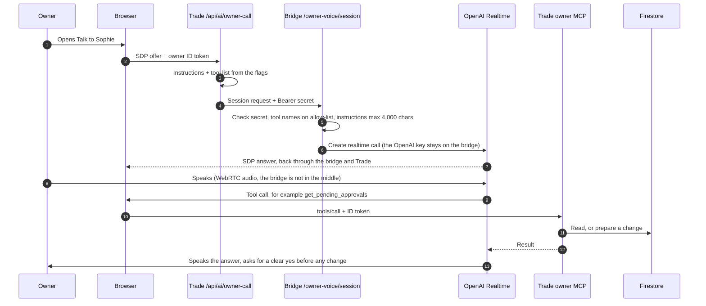

- **The bridge is only used to start the session.** After that, audio goes straight between the browser and OpenAI, and tools run on Trade.
- **What this means for every automation with a voice part:** its tool name must be added to the allow-list in `trade-owner-voice.mjs`, and the bridge restarted, **before** the Trade flag is turned on. Otherwise the bridge rejects the whole session.

#### Path B: Call (Sophie phones a customer)

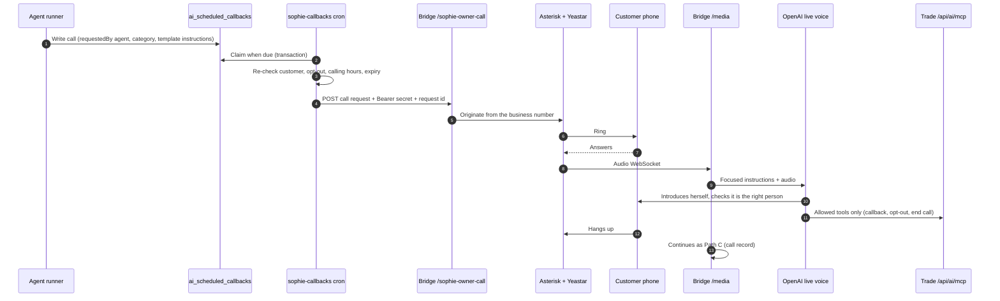

- **Customer calls coming in come first.** If the bridge is full, the worker waits and tries later.
- **The bridge already runs a focused call** with no booking, payment or record-change tools. Sophie says nothing private to voicemail or the wrong person.

#### Path C: Record (a phone call starts an automation)

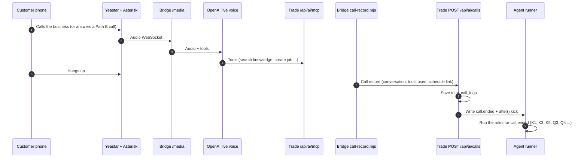

- **The call record is the only thing the bridge sends after a call.** Every automation that reacts to a call starts from it.
- **Only one event per call.** The event id is `call.ended:{callLogId}`, so a repeated POST never runs an automation twice.

### 1.2 Does an automation need the voice bridge running?

**Not always.** The automations run in **Trade** (the agent runner), not in the bridge. The bridge is only needed when a **phone call** has to happen, or when the owner wants to do something **by voice**.

| Group | Automations | If the bridge is down |
|---|---|---|
| **Needs the bridge**: its main job is a phone call | K1, K5, Q3, H3 | K1's call waits, then expires like any scheduled call. K5 and Q3 have nothing to do, because no calls come in. H3 is the alarm that says the bridge is down |
| **Partly**: one step is a call | S1, S8, M2, K3, Q4 | The email, SMS or report step still works. Only the call step waits or is skipped |
| **Voice is optional** | S2, S3, S5, S6, S7, D1, D2, D3, D6, M3, M4, M5, M6, K2, T2, T3, Q1, Q2, H2 | Works fully. The owner uses the dashboard and push instead of talking to Sophie |
| **Never uses the bridge** | S4, D4, D5, M1, M7, K4, T1, H1, H4, H5 | No effect |

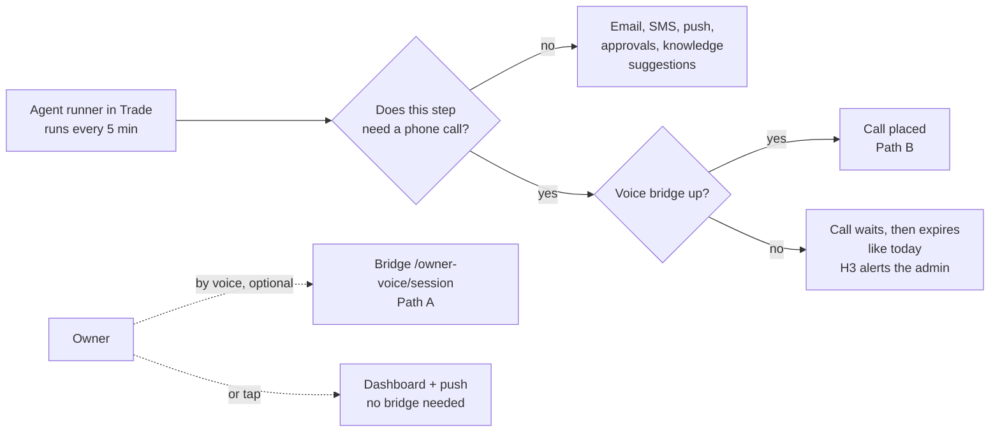

**What must be running for automations to work with nobody at the dashboard:**

| Part | Needed for | Where it must run |
|---|---|---|
| Trade, deployed, with its crons (`vercel.json`) | All 38 | Hosted. Local `next dev` runs **no** crons |
| Voice bridge | Calls (Paths B and C) and voice (Path A) | On the **server**, all day. In local setup A (bridge on the laptop through the SSH tunnel), calls stop whenever the laptop is off or asleep |
| Asterisk and Yeastar | Calls | The server (as today) |
| A connected business mailbox | Email automations | Settings → Emails |
| SMS credit | SMS automations | SMS packages |

---

## 2. All automations on one page

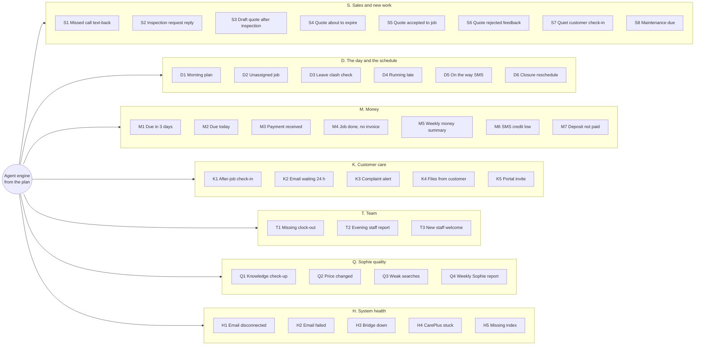

---

## 3. S. Sales and new work

### S1. Missed call: instant text-back

- **When:** a call to the business number is missed. This is the same record that starts today's missed-call retry.
- **Sophie does:** sends one SMS within a minute: *"Sorry we missed your call to {Business}. Sophie will call you back shortly, or book online: {link}."* The existing Sophie callback retry then runs as usual.
- **Who hears about it:** the caller, by SMS. **Level:** `auto`.
- **Voice bridge:** **Record and Call.** The phone system records the miss, and the bridge later places the existing callback.
- **Builds on:** missed calls (`lib/notifications/missed-calls-context.tsx`, Calls → Missed calls), the callback worker (`lib/ai/calls/run-sophie-callbacks.ts`), SMS sending (`lib/sms/textbee.ts`), and the SMS balance.
- **New:** event `missed_call.created`, template `sms/missed-call-textback.ts`.
- **Safety:**
  - Skip numbers blocked in Calls → Missed calls, private numbers, and landlines that can't receive SMS.
  - One text per number per day.
  - Skip if the SMS credit is low (see M6).
  - Inbound SMS isn't read today, so the text never asks a question that needs a text reply.

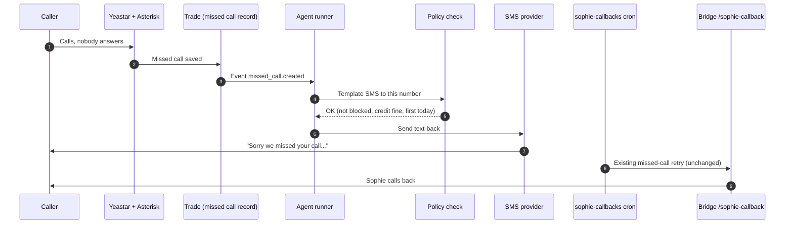

### S2. New online inspection request: quick reply and proposed times

- **When:** a customer books an inspection online. Today this goes through `app/api/booking/inspection-request` and creates a `request_created` notification.
- **Sophie does:**
  1. Emails the customer straight away: *"We got your request. We'll confirm a time soon."*
  2. Checks free slots (`app/api/booking/slot-availability`) and the staff available, then **proposes two times** to the owner.
  3. After the owner picks one, the existing "proposed" flow (`request_proposed`) tells the customer.
- **Who hears about it:** the customer by email (`auto`); the owner gets the proposal by push (`suggest`).
- **Voice bridge:** **Session.** The owner can say "Sophie, any new inspection requests?" and then pick a time by voice with `prepare_inspection_schedule`.
- **Builds on:** `lib/inspection/server.ts`, slot availability, `lib/team/staff-availability.ts`, and the owner tool `prepare_inspection_schedule`.
- **New:** event `inspection_request.created`, template `email/inspection-received.ts`, action `propose-times.ts`.
- **Safety:** proposals are never sent to the customer without the owner, and the slot is checked again at the moment of confirming.

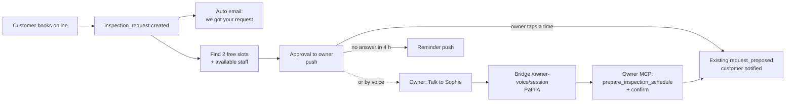

### S3. Inspection completed: draft quote

- **When:** an inspection is marked completed and it has notes, photos or a voice note.
- **Sophie does:** drafts a quote from the inspection notes, the business's items and services and their prices. It uses the existing voice-quotation drafting. The draft goes to the owner and is **never sent automatically**.
- **Who hears about it:** the owner (push and an approval). **Level:** always `suggest`.
- **Voice bridge:** **Session.** "Sophie, read me the draft quote for John" uses the new `get_draft_quotes`. The owner then edits it in Quotations.
- **Builds on:** `app/api/quotations/voice-draft`, `lib/ai/quotation/voice-draft.ts` (`AI_QUOTATION_MODEL`), items and services.
- **New:** event `inspection.completed`, action `draft-quote.ts`.
- **Safety:** prices come only from saved items and services. A line with no matching item is marked "price needed" and never guessed.

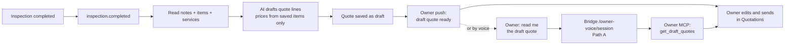

### S4. Quote about to expire: last reminder

- **When:** a quote is `sent`, has no answer, and its valid-until date is 2 days away.
- **Sophie does:** sends *"Your quote {number} is valid until {date}. Reply or click to accept: {link}."*
- **Who hears about it:** the customer by email. **Level:** `auto` (template).
- **Voice bridge:** none.
- **Builds on:** quotations (`lib/quotations/server.ts`), the quote pay and accept link (`resolveQuotationPayUrl`).
- **New:** scan `quote.expiring`, template `email/quote-expiring.ts`.
- **Safety:** skip if plan rule E3 or C1 already contacted the customer in the last 48 hours. Stop the moment the quote is accepted or rejected.

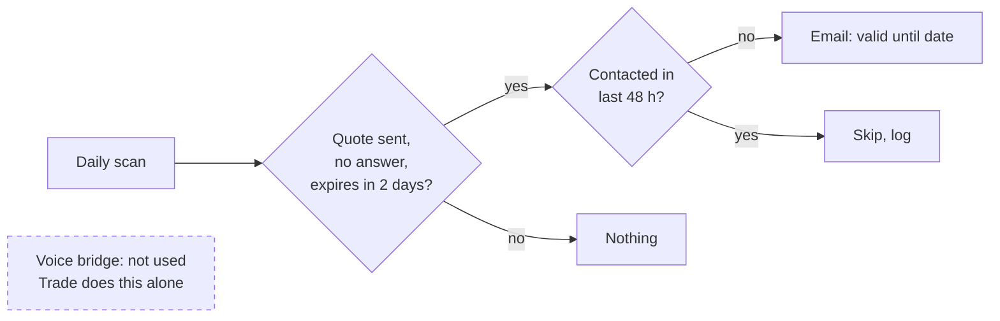

### S5. Quote accepted: job draft, staff proposal and confirmation

- **When:** a quote becomes accepted. Today this creates a `quotation_accepted` notification.
- **Sophie does:**
  1. Prepares a **job draft** from the quote.
  2. Picks the best staff member with the existing AI assignment planner (`planTradeStaffAssignment`).
  3. Proposes a date to the owner.
  4. After the owner confirms, sends the customer a confirmation (plan rule E1).
- **Who hears about it:** the owner gets the proposal (`suggest`); the customer gets a confirmation (`auto`, after the owner says yes).
- **Voice bridge:** **Session.** "Sophie, John accepted. Book him in." The owner confirms with the existing `prepare_job_create` or `prepare_job_assignment`.
- **Builds on:** `lib/team/ai-assignment-planner.ts`, `lib/bookings/resolve-job-assignment.ts`, `prepare_job_create`.
- **New:** event `quote.accepted`, action `propose-job.ts`.
- **Safety:** nothing is booked without the owner. Staff leave and off days are checked (`lib/leave/conflicts.ts`, `lib/team/staff-off-day-server.ts`).

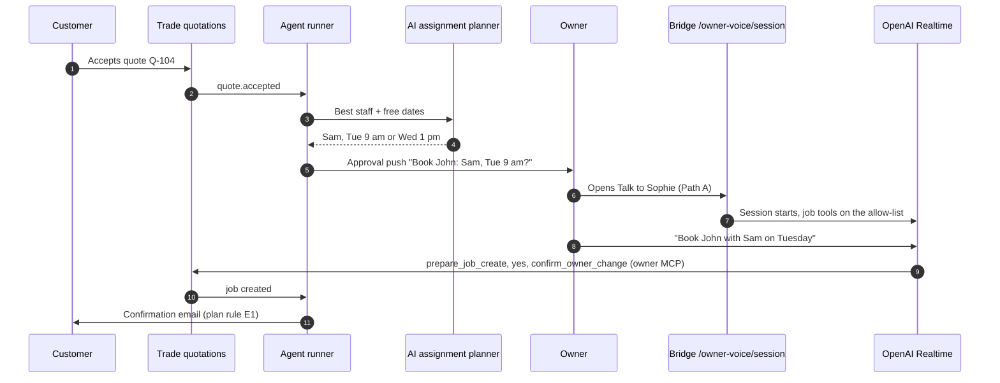

### S6. Quote rejected: ask why, learn from it

- **When:** a quote is rejected (`quotation_rejected`).
- **Sophie does:**
  1. Sends one short email: *"Thanks for considering us. Could you tell us why? Price / timing / chose someone else / other."* The options are links, so no reply needs to be read.
  2. Adds the answers to a monthly push for the owner: *"3 quotes lost on price this month."*
- **Who hears about it:** the customer by email (`suggest` at first); the owner by monthly push (`auto`).
- **Voice bridge:** **Session.** "Sophie, why are we losing quotes?" uses `get_quote_insights`.
- **Builds on:** quotations, the email outbox.
- **New:** event `quote.rejected`, template `email/quote-feedback.ts`, a feedback link route, insight `report.ts`.
- **Safety:** one email per rejected quote, never a follow-up to the feedback email, and no feedback request for a quote that was disputed.

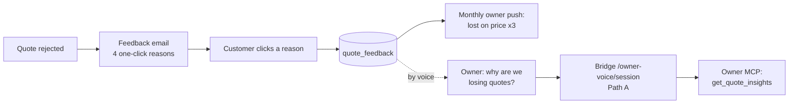

### S7. Quiet customer: check-in (marketing, needs consent)

- **When:** a customer has had no job for 12 months **and** has given **marketing consent**.
- **Sophie does:** sends one friendly check-in with a booking link. It goes in small batches through the existing broadcasts.
- **Who hears about it:** customers by email (or SMS). **Level:** `suggest`, where the owner approves the **batch**, not each message.
- **Voice bridge:** **Session.** "Sophie, who haven't we seen in a year?" uses the new `get_dormant_customers`. The batch can also be approved by voice with the plan's approval tools.
- **Builds on:** customer history (`app/api/customers/[id]/history`), broadcasts (`lib/broadcasts/server.ts`), the Custom messages page.
- **New:** scan `customer.dormant`, a `marketingConsent` field on the customer, template `email/check-in.ts`.
- **Safety:**
  - Marketing law applies (for example Australia's Spam Act: consent, sender ID and unsubscribe).
  - **Off unless consent is recorded.**
  - At most once every 6 months per customer.

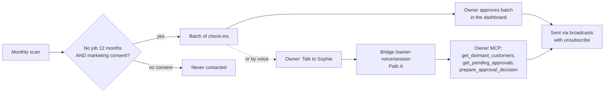

### S8. Maintenance due (recurring service)

- **When:** a service that repeats (yearly gas check, six-monthly gutter clean) is due in 30 days and no next job is booked. Recurring jobs already exist (`lib/bookings/recurrence.ts`, `series-records.ts`).
- **Sophie does:** *"Your yearly {service} is due in {month}. Book a time: {link}."* If the customer doesn't book, she can propose a follow-up call (`suggest`).
- **Who hears about it:** the customer by email or SMS. **Level:** `auto` for customers with an active recurring series; consent is needed for anyone else.
- **Voice bridge:** **Call (Path B).** This is an optional follow-up call, using the same path as plan section 7. Its call record then comes back through Path C.
- **Builds on:** booking series, service templates (`app/api/service-templates`).
- **New:** scan `maintenance.due`, template `email/maintenance-due.ts`.
- **Safety:** stop once a job is booked, and never more than 2 reminders per cycle.

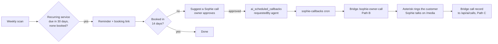

---

## 4. D. The day and the schedule

### D1. Morning plan for the owner

- **When:** every working day at a time the owner picks (default 7 am).
- **Sophie does:** sends one push: *"Today: 6 jobs, 1 unassigned, Sam on leave (clashes with job J-221), 2 quotes waiting, 1 approval."* Tapping it opens the day view.
- **Who hears about it:** the owner by push. **Level:** `auto` (owner only).
- **Voice bridge:** **Session.** "Sophie, what's today?" uses the same data through the existing `get_daily_summary`, `get_staff_working_today` and `get_work_visits`. **Later (plan phase 7):** Sophie phones the owner with the plan.
- **Builds on:** the owner briefing tools (`lib/ai/mcp/tools/owner-briefing.tools.ts`), `findLeaveAssignmentConflicts` (`lib/leave/conflicts.ts`), approvals.
- **New:** a morning plan in `report.ts`, scheduled by the hourly report cron.
- **Safety:** none extra. It only reads data.

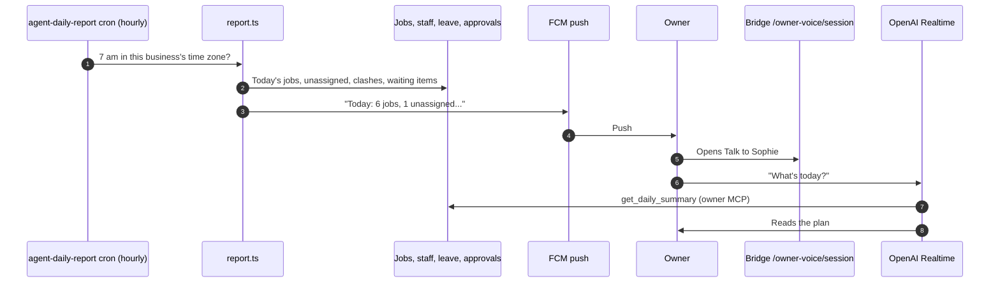

### D2. Job tomorrow still unassigned: staff proposal

- **When:** a job starts within 24 hours and has no staff assigned.
- **Sophie does:** runs the AI assignment planner and proposes the best available person.
- **Who hears about it:** the owner (`suggest`). Assigning staff is an internal change, so after enough approvals in a row the owner can allow `auto`.
- **Voice bridge:** **Session.** "Assign Sam to tomorrow's job" uses the existing `prepare_job_assignment`.
- **Builds on:** `lib/team/ai-assignment-planner.ts`, `lib/team/staff-availability.ts`, `lib/team/staff-assign-blocks.ts`.
- **New:** scan `job.unassigned_soon`, action `propose-assignment.ts`.
- **Safety:** only staff who can do the service (`staffCanPerformService`), are not on leave and have no clash.

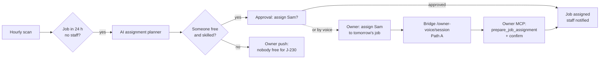

### D3. Leave request: clash check and suggested cover

- **When:** a staff member asks for leave (`leave_requested`).
- **Sophie does:** checks every job and request in those days. She tells the owner: *"Sam asks for Mon–Tue. 3 jobs clash. Alex can cover 2. Nobody free for J-240."*
- **Who hears about it:** the owner by push. **Level:** `auto` for the summary. The decision stays with the owner.
- **Voice bridge:** **Session.** "Approve Sam's leave and give his jobs to Alex" uses the existing `prepare_leave_decision` and `prepare_job_assignment`.
- **Builds on:** `lib/leave/conflicts.ts`, the `leave_assignment_conflict` notification, the AI assignment planner.
- **New:** event `leave.requested`, the summary in `report.ts`.
- **Safety:** Sophie never approves or declines leave by herself.

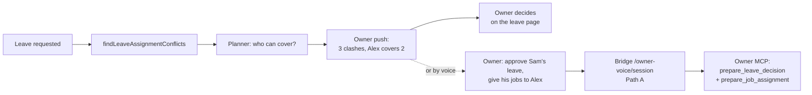

### D4. Staff running late: tell the customer

- **When:** 15 minutes after a job's start time, the staff member hasn't pressed "on the way" or clocked in.
- **Sophie does:**
  1. Asks the staff member (push): *"Running late for J-221?"*
  2. If they don't answer in 5 minutes, or they answer "yes, 20 min", she drafts the SMS *"Sorry, {staff} is running about {n} minutes late."*
- **Who hears about it:** staff (push), the owner (push) and the customer (SMS). **Level:** `suggest` at first, then `auto` once the owner trusts it.
- **Voice bridge:** none.
- **Builds on:** the `visit_on_the_way` and `booking_on_the_way` notifications, attendance (`lib/team/attendance.ts`).
- **New:** scan `job.not_started`, template `sms/running-late.ts`.
- **Safety:** one late message per job, and no guessed time. The minutes come from the staff member, or the message says "a little late".

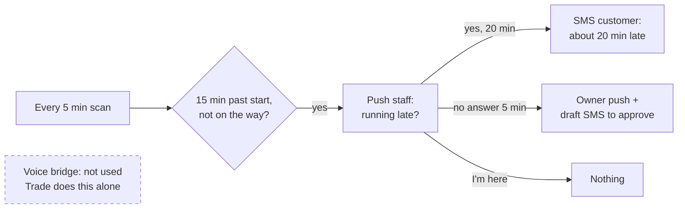

### D5. Staff on the way: SMS to the customer

- **When:** staff press "on the way". This already creates `visit_on_the_way` or `booking_on_the_way`, and portal customers already see it.
- **Sophie does:** for customers **without** the portal app, sends an SMS: *"{staff} from {Business} is on the way."*
- **Who hears about it:** the customer by SMS. **Level:** `auto`.
- **Voice bridge:** none.
- **Builds on:** the existing on-the-way notifications and customer notifications (`lib/notifications/server.ts`).
- **New:** event `job.on_the_way`, template `sms/on-the-way.ts`.
- **Safety:** no SMS if the customer already got the portal push, and one per job.

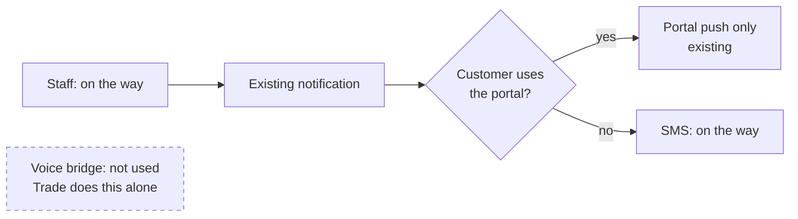

### D6. Business closure added: reschedule affected jobs

- **When:** the owner adds a closure day (public holiday, sick day) in Calendar (`app/api/calendar/business-closures`).
- **Sophie does:** finds every job and inspection on those days, proposes new times with the planner, and drafts messages to each customer.
- **Who hears about it:** the owner first (`suggest`), then customers (email or SMS) once approved.
- **Voice bridge:** **Session.** "Move Friday's jobs to Monday."
- **Builds on:** business closures, slot availability, `prepare_job_schedule` and `prepare_inspection_schedule`.
- **New:** event `closure.added`, action `propose-reschedule.ts`.
- **Safety:** the owner approves each move. Customers are only told after the new time is saved.

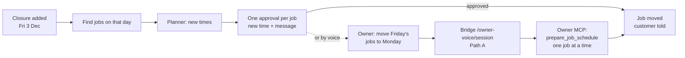

---

## 5. M. Money

### M1. Invoice due in 3 days: friendly reminder

- **When:** an invoice is `sent`, not paid, and due in 3 days.
- **Sophie does:** *"Invoice {number} for ${amount} is due on {date}. Pay online: {link}."*
- **Who hears about it:** the customer by email. **Level:** `auto` (template).
- **Voice bridge:** none.
- **Builds on:** `resolveInvoicePaymentDue` (`lib/invoices/payment-due.ts`), `resolveInvoicePayUrl` (`lib/payments/document-pay-link.ts`), and the outbox.
- **New:** scan `invoice.due_soon`, template `email/invoice-due-soon.ts`.
- **Safety:**
  - The amount always comes from `outstandingAmountAud`.
  - **M3 must be live first**, so a payment stops the reminders.
  - Skip if the invoice is disputed.

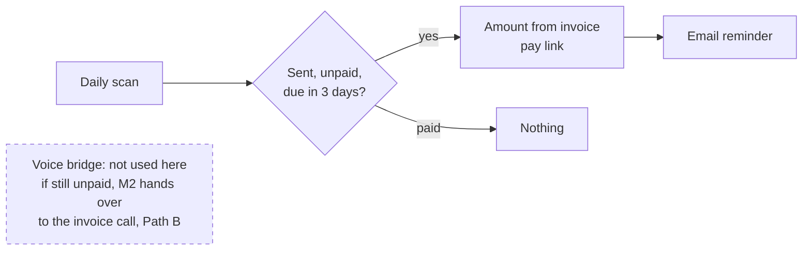

### M2. Invoice due today, then the overdue chain

- **When:** the due date arrives and the invoice is unpaid.
- **Sophie does:** emails a reminder with the pay link that day. If it is still unpaid **after** the due date, the **existing** overdue-invoice flow takes over: the `/api/cron/overdue-invoices` email and Sophie's invoice call.
- **Who hears about it:** the customer by email (`auto`), then by a call (existing switches).
- **Voice bridge:** **Call.** The existing `/sophie-invoice-call`.
- **Builds on:** the overdue-invoices cron, `AI_SOPHIE_INVOICE_CALLS_ENABLED` and the owner's "Sophie invoice calls" setting.
- **New:** scan `invoice.due`, template `email/invoice-due.ts`. Make sure the overdue cron and this rule never send on the same day.
- **Safety:** the existing invoice-call safeguards (`docs/sophie-call-safety.md`).

```mermaid
sequenceDiagram
  autonumber
  participant R as Agent runner
  participant C as Customer
  participant OD as overdue-invoices cron (existing)
  participant W as sophie-callbacks cron
  participant BR as Bridge /sophie-invoice-call
  participant AI as Sophie on the phone
  R->>C: Due today email + pay link
  Note over R,C: Customer pays, then M3 stops everything
  OD->>OD: Next days, still unpaid
  OD->>W: Queue invoice call (if enabled)
  W->>BR: Place call
  BR->>AI: Focused invoice call
  AI->>C: "Hi, this is Sophie about invoice 1042..."
```

### M3. Payment received: receipt, stop reminders, tell the owner

- **When:** Stripe confirms a payment. The webhook (`app/api/stripe/webhook/route.ts`) already handles `checkout.session.completed` and `checkout.session.async_payment_succeeded`.
- **Sophie does:**
  1. Emails the customer a thank-you and receipt.
  2. **Cancels every pending reminder, approval and scheduled call** for that invoice.
  3. Pushes the owner: *"John paid $420 for INV-1042."*
- **Who hears about it:** the customer by email (`auto`) and the owner by push (`auto`).
- **Voice bridge:** none, but it **cancels** any queued invoice call before the bridge places it.
- **Builds on:** the Stripe webhook, payments confirm, `ai_scheduled_callbacks` cancellation (the same transaction as the owner's cancel).
- **New:** event `payment.received`, template `email/payment-receipt.ts`, action `cancel-pending-for-entity.ts`.
- **Safety:** only on a **confirmed** Stripe payment. "I paid" said on a call or in an email is never treated as payment.

```mermaid
flowchart LR
  A["Stripe webhook<br/>payment confirmed"] --> B["payment.received"]
  B --> C["Receipt email"]
  B --> D["Cancel reminders,<br/>approvals, invoice calls"]
  D --> G["ai_scheduled_callbacks<br/>cancelled in a transaction"]
  G -. "the call never reaches" .-> BR["Bridge /sophie-invoice-call<br/>Path B"]
  B --> E["Owner push:<br/>John paid $420"]
```

### M4. Job done, no invoice: remind the owner and draft one

- **When:** a job has been `completed` for 24 hours and has no invoice.
- **Sophie does:** drafts an invoice from the job's quote, items and time. She pushes the owner: *"J-221 is done but not invoiced. A draft is ready."*
- **Who hears about it:** the owner. **Level:** `suggest`. Invoices are never sent automatically.
- **Voice bridge:** **Session.** "Sophie, which jobs aren't invoiced?"
- **Builds on:** `job_completed`, invoices (`lib/invoices/server.ts`), `lib/invoices/enrich-quotations.ts`.
- **New:** scan `job.completed_no_invoice`, action `draft-invoice.ts`.
- **Safety:** prices are copied from the accepted quote or saved items only.

```mermaid
flowchart LR
  A["Daily scan"] --> B{"Completed 24 h ago,<br/>no invoice?"}
  B -- "yes" --> C["Draft invoice from<br/>quote + items"]
  C --> D["Owner push +<br/>approval"]
  D -- "owner checks" --> E["Owner sends it<br/>in Invoices"]
  D -. "or by voice" .-> V1["Owner: which jobs<br/>aren't invoiced?"]
  V1 --> V2["Bridge /owner-voice/session<br/>Path A"]
  V2 --> V3["Owner MCP:<br/>get_uninvoiced_jobs"]
```

### M5. Weekly money summary

- **When:** Monday at 8 am in the business time zone.
- **Sophie does:** *"Last week: $8,420 paid. $3,100 outstanding, $900 overdue (2 invoices). 4 quotes waiting, worth $12,000."*
- **Who hears about it:** the owner by push and email. **Level:** `auto` (owner only).
- **Voice bridge:** **Session.** "Sophie, how did we do last week?"
- **Builds on:** invoices and quotations, `outstandingAmountAud`.
- **New:** a weekly money section in `report.ts`.
- **Safety:** read only.

```mermaid
flowchart LR
  A["Monday 8 am"] --> B["Sum paid, outstanding,<br/>overdue, open quotes"]
  B --> C["Owner push + email"]
  V1["Owner: how did we<br/>do last week?"] --> V2["Bridge /owner-voice/session<br/>Path A"]
  V2 --> V3["Owner MCP:<br/>get_money_summary"]
  B -. "same numbers" .-> V3
```

### M6. SMS credit low

- **When:** the SMS balance drops under a threshold (default 50 messages), or an SMS automation is blocked for lack of credit.
- **Sophie does:** *"SMS credit is low (42 left). Top up: {link}."*
- **Who hears about it:** the owner by push. **Level:** `auto` (owner only).
- **Voice bridge:** **Session.** "How much SMS credit is left?" uses the existing `get_sms_balance`.
- **Builds on:** `lib/sms/usage.ts`, SMS packages (`app/dashboard/sms-packages`).
- **New:** event `sms.balance_low`.
- **Safety:** at most once a day. Sophie never buys credit herself.

```mermaid
flowchart LR
  A["SMS sent or blocked"] --> B{"Balance under 50?"}
  B -- "yes, first today" --> C["Owner push + top-up link"]
  V1["Owner: how much SMS<br/>credit is left?"] --> V2["Bridge /owner-voice/session<br/>Path A"]
  V2 --> V3["Owner MCP:<br/>get_sms_balance (existing)"]
  B -- "no" --> D["Nothing"]
```

### M7. Deposit not paid before the job

- **When:** the business takes quote payments, the quote is accepted, the deposit is unpaid, and the job is in 3 days.
- **Sophie does:** emails the deposit link. If it is still unpaid the day before, she pushes the owner: *"John's deposit isn't paid. The job is tomorrow."*
- **Who hears about it:** the customer by email (`auto`) and the owner by push.
- **Voice bridge:** none.
- **Builds on:** `resolveQuotationPayUrl`, payments.
- **New:** scan `deposit.unpaid`, template `email/deposit-due.ts`.
- **Safety:** only for businesses that use quote payments. Sophie never cancels a job for non-payment; the owner decides.

```mermaid
flowchart LR
  A["Daily scan"] --> B{"Accepted, deposit unpaid,<br/>job in 3 days?"}
  B -- "yes" --> C["Email deposit link"]
  C --> D{"Paid by<br/>day before?"}
  D -- "no" --> E["Owner push"]
  D -- "yes" --> F["Done"]
  NB["Voice bridge: not used<br/>Trade does this alone"]:::nobridge
  classDef nobridge stroke-dasharray: 5 5
```

---

## 6. K. Customer care

### K1. After-job check-in call and review request

- **When:** 2 days after a job is completed.
- **Sophie does:** calls the customer: *"Are you happy with the work? Is anything still to fix?"* This is plan rule C3. Whatever the answer, she then emails **a review link to every customer she reached**.
- **Who hears about it:** the customer by call and email; the owner by push if anything is wrong. **Level:** `suggest`.
- **Voice bridge:** **Call.** It uses the owner-requested call path, with `requestedBy: "agent"` and category `service`.
- **Builds on:** plan section 7, `trade-owner-requested-call.mjs`, `lib/ai/calls/summarize.ts`.
- **New:** call template `call/after-job-check.ts`, email template `email/review-request.ts`.
- **Safety:**
  - **Do not send review links only to happy customers.** Google and other platforms forbid "review gating". Everyone reached gets the same link.
  - An unhappy answer creates an owner task and stops other automations for that customer.

```mermaid
sequenceDiagram
  autonumber
  participant R as Agent runner
  participant SC as ai_scheduled_callbacks
  participant BR as Bridge /sophie-owner-call
  participant C as Customer
  participant MED as Bridge /media + OpenAI
  participant CR as Trade /api/ai/calls
  participant O as Owner
  R->>SC: After-job check call (requestedBy agent)
  SC->>BR: Worker places the call
  BR->>C: Ring
  C->>MED: "The tap still drips a bit"
  MED->>CR: Call record after hang-up
  CR->>R: call.ended
  R->>R: Sum up: reached, needsOwner = yes
  R->>O: Push "John: tap still drips"
  R->>C: Review link email (same for everyone reached)
```

### K2. Customer email waiting over 24 hours

- **When:** a saved customer's email in the inbox has had no reply from the business for 24 working hours.
- **Sophie does:** pushes the owner: *"John's email 'Leaking tap' has waited 26 hours."* If E7 (plan) is on, a draft reply is attached.
- **Who hears about it:** the owner. **Level:** `auto` (owner only).
- **Voice bridge:** **Session.** "Read me John's email," then the existing `get_email_thread` and `prepare_email_send`.
- **Builds on:** `email_messages` (folder, linked, sentAt), the threads, `get_emails`.
- **New:** scan `email.unanswered`.
- **Safety:** read only. Weekends and closures don't count toward the 24 hours.

```mermaid
flowchart LR
  A["Hourly scan"] --> B{"Customer email,<br/>no reply 24 working h?"}
  B -- "yes" --> C["Owner push<br/>+ draft if E7 on"]
  C --> D["Owner replies<br/>on the Emails page"]
  C -. "or by voice" .-> V1["Owner: read me<br/>John's email"]
  V1 --> V2["Bridge /owner-voice/session<br/>Path A"]
  V2 --> V3["Owner MCP:<br/>get_email_thread,<br/>prepare_email_send + confirm"]
```

### K3. Complaint alert

- **When:** a complaint is found in a **call record** (the bridge) or an **incoming email** (E7 sorting).
- **Sophie does:**
  1. Sends an urgent owner push with a short summary.
  2. **Pauses every automation for that customer** until the owner clears it.
  3. Drafts a calm reply for the owner to edit.
- **Who hears about it:** the owner, immediately. **Level:** `auto` for the alert and pause; `suggest` for the reply.
- **Voice bridge:** **Record.** The complaint is found in the call log the bridge posts.
- **Builds on:** the call summaries (`lib/ai/calls/summarize.ts`), the owner alert pattern (`lib/notifications/sophie-owner-alert.ts`).
- **New:** a `complaint` flag in the writer's call and email sorting, and a customer `automationHold` field.
- **Safety:** no automatic message to an unhappy customer, ever.

```mermaid
sequenceDiagram
  autonumber
  participant C as Customer
  participant BR as Bridge /media
  participant CR as Trade /api/ai/calls
  participant R as Agent runner
  participant W as Writer
  participant O as Owner
  C->>BR: "The job was terrible, nobody came back"
  BR->>CR: Call record
  CR->>R: call.ended
  R->>W: Sort the call
  W-->>R: complaint = yes, summary
  R->>R: Set automationHold on John
  R->>O: Urgent push + draft reply to edit
```

### K4. Photos or files emailed by a customer

- **When:** a saved customer emails attachments (photos, PDFs) that relate to an open request or job.
- **Sophie does:** suggests attaching them to that job or request: *"John sent 3 photos. Add them to J-221?"*
- **Who hears about it:** the owner. **Level:** `suggest`.
- **Voice bridge:** none.
- **Builds on:** mailbox attachments, customer documents (`app/api/customer/documents`).
- **New:** event `email.attachment`, action `attach-to-job.ts`.
- **Safety:** only images and PDFs under the size limit, and only to that customer's open jobs.

```mermaid
flowchart LR
  A["Customer email<br/>with photos"] --> B{"Open job or request<br/>for this customer?"}
  B -- "one match" --> C["Approval: add to J-221?"]
  B -- "several" --> D["Owner picks the job"]
  C -- "approved" --> E["Saved to job documents"]
  NB["Voice bridge: not used<br/>Trade does this alone"]:::nobridge
  classDef nobridge stroke-dasharray: 5 5
```

### K5. New customer from a Sophie call: portal invite

- **When:** Sophie created a new customer during a phone call.
- **Sophie does:** sends the customer-portal invite, so the customer can see the job, quotes and invoices.
- **Who hears about it:** the customer by email. **Level:** `suggest` at first.
- **Voice bridge:** **Record.** The customer was created on a bridge call.
- **Builds on:** the customer invite flow (`docs/customer-invite-and-activation-changes.md`).
- **New:** event `customer.created_by_sophie`.
- **Safety:** only when the email address was read back and confirmed on the call.

```mermaid
flowchart LR
  A["Customer calls<br/>Bridge /media"] --> B["Sophie creates customer<br/>via /api/ai/mcp"]
  B --> C["Bridge call-record.mjs<br/>POST /api/ai/calls, Path C"]
  C --> D{"Email confirmed<br/>on the call?"}
  D -- "yes" --> E["Approval: send portal invite"]
  D -- "no" --> F["Owner task: get email"]
```

---

## 7. T. Team

### T1. Missing clock-out

- **When:** at 7 pm, a staff member clocked in today but not out.
- **Sophie does:** pushes the staff member: *"You didn't clock out today. Tap to fix."* If it is still missing the next morning, the owner hears about it.
- **Who hears about it:** staff, then the owner. **Level:** `auto` (internal).
- **Voice bridge:** none.
- **Builds on:** attendance (`lib/team/attendance.ts`, `app/api/team/attendance`).
- **New:** scan `staff.missing_clock_out`.
- **Safety:** Sophie never fills in a clock-out time herself.

```mermaid
flowchart LR
  A["7 pm scan"] --> B{"Clocked in,<br/>not out?"}
  B -- "yes" --> C["Push staff"]
  C --> D{"Fixed by<br/>morning?"}
  D -- "no" --> E["Owner push"]
  NB["Voice bridge: not used<br/>Trade does this alone"]:::nobridge
  classDef nobridge stroke-dasharray: 5 5
```

### T2. Evening staff report

- **When:** a time the owner picks (default 6 pm). It goes in the plan's daily report.
- **Sophie does:** *"Today: Sam 3 jobs, 7.5 h. Alex 2 jobs, 6 h, 1 job still ongoing."*
- **Who hears about it:** the owner. **Level:** `auto` (owner only).
- **Voice bridge:** **Session.** The existing `get_staff_day_report`.
- **Builds on:** the staff day report, attendance.
- **New:** a section in `report.ts`.
- **Safety:** read only.

```mermaid
flowchart LR
  A["6 pm"] --> B["get_staff_day_report data"] --> C["Inside the daily report push"]
  V1["Owner: how did the<br/>team do today?"] --> V2["Bridge /owner-voice/session<br/>Path A"]
  V2 --> V3["Owner MCP:<br/>get_staff_day_report (existing)"]
```

### T3. New staff member: welcome and app setup

- **When:** a staff member is created, either in Team or by voice (`prepare_staff_create`).
- **Sophie does:** emails the person a welcome, with the app download link and first-login steps.
- **Who hears about it:** the new staff member by email. **Level:** `auto` (template).
- **Voice bridge:** **Session**, when the owner created the staff member by voice.
- **Builds on:** team staff creation (`app/api/team/staff`).
- **New:** event `staff.created`, template `email/staff-welcome.ts`.
- **Safety:** no passwords in email. It uses the normal invite or sign-in link only.

```mermaid
flowchart LR
  P["Staff created<br/>on the Team page"] --> B["staff.created"] --> C["Welcome email<br/>+ app link"]
  V1["Owner: add Sam<br/>as a technician"] --> V2["Bridge /owner-voice/session<br/>Path A"]
  V2 --> V3["Owner MCP:<br/>prepare_staff_create + confirm"]
  V3 --> B
```

---

## 8. Q. Sophie's own quality

### Q1. Knowledge check-up

- **When:** weekly. It finds published knowledge entries that contain a price, a date or a phone number and haven't been changed for 6 months.
- **Sophie does:** asks the owner to confirm up to 3 entries a week: *"Is 'call-out fee $90' still right?"*
- **Who hears about it:** the owner by push, and in Talk to Sophie. **Level:** `suggest`.
- **Voice bridge:** **Session.** "Yes, still right" marks the entry as checked. "No, it's $95" goes to the existing `prepare_knowledge_update`.
- **Builds on:** knowledge entries (`updatedAt`), `prepare_knowledge_update`.
- **New:** scan `knowledge.stale`, a `lastConfirmedAt` field, and the tool `confirm_knowledge_current`.
- **Safety:** Sophie never changes an entry without the owner.

```mermaid
flowchart LR
  A["Weekly scan"] --> B["Entries with price/date<br/>unchanged 6 months"]
  B --> C["Ask owner: still right?"]
  C -- "yes" --> D["lastConfirmedAt = now"]
  C -- "no, new value" --> E["prepare_knowledge_update<br/>+ confirm"]
  C -. "asked in Talk to Sophie" .-> V2["Bridge /owner-voice/session<br/>Path A"]
  V2 --> V3["Owner MCP:<br/>confirm_knowledge_current<br/>or prepare_knowledge_update"]
  V3 --> D
  V3 --> E
```

### Q2. Price changed: update knowledge too

- **When:** a service or item price changes, on the page or by voice (`prepare_service_update`, `prepare_item_update`).
- **Sophie does:** searches knowledge for the **old** price and the service name. Then: *"Your FAQ 'Hot water service' still says $180. Change it to $195?"*
- **Who hears about it:** the owner. **Level:** `suggest`.
- **Voice bridge:** **Session.** When the owner changes a price by voice, Sophie asks about the knowledge straight after.
- **Builds on:** services and items, `searchPassages` (`lib/ai/rag/retriever.ts`).
- **New:** event `service.price_changed`, suggestion type `price_mismatch` in `ai_knowledge_suggestions`.
- **Safety:** it is a suggestion only, and callers keep hearing the old text until the owner publishes.

```mermaid
flowchart LR
  A["Price $180 to $195<br/>on the Services page"] --> B["service.price_changed"]
  V1["Owner by voice:<br/>hot water service is now $195"] --> V2["Bridge /owner-voice/session<br/>Path A"]
  V2 --> V3["Owner MCP:<br/>prepare_service_update + confirm"]
  V3 --> B
  E -. "same voice session" .-> V4["Sophie asks right away:<br/>update the FAQ too?"]
  B --> C["Search knowledge for<br/>$180 + service name"]
  C --> D{"Found?"}
  D -- "yes" --> E["Suggestion:<br/>update FAQ?"]
  D -- "no" --> F["Nothing"]
```

### Q3. Weak searches: fill the gaps

- **When:** daily. It reads the search log for questions where Sophie found nothing, or only weak matches, on calls.
- **Sophie does:** groups them and adds them to the knowledge suggestions (plan Feature 1, source C): *"Customers asked about weekend rates 4 times."*
- **Who hears about it:** the owner. **Level:** `suggest`.
- **Voice bridge:** **Record and Session.** The searches happen on bridge calls, and the owner answers by voice.
- **Builds on:** `lib/ai/rag/search-log.ts`, `search-stats.ts`, `app/api/ai/knowledge/search-logs`, `lib/ai/learning/unanswered.ts`.
- **New:** grouping in `lib/ai/learning/suggest-from-searches.ts`.
- **Safety:** questions only. Callers' words are never stored as facts.

```mermaid
sequenceDiagram
  autonumber
  participant C as Caller
  participant BR as Bridge /media
  participant MCP as Trade /api/ai/mcp
  participant SL as Search log
  participant R as Agent runner
  participant S as ai_knowledge_suggestions
  participant O as Owner (Talk to Sophie)
  C->>BR: "Do you charge more on weekends?"
  BR->>MCP: search knowledge
  MCP->>SL: Logged, weak match
  R->>SL: Daily read
  R->>S: "Weekend rates asked 4 times"
  O->>S: "Any questions waiting?"
  O->>O: Answers, saved as a draft (plan 5.4)
```

### Q4. Weekly Sophie report

- **When:** Monday morning.
- **Sophie does:** *"Last week Sophie answered 41 calls, booked 9 jobs, passed 5 to you, and missed 3 questions. Automations sent 22 emails and made 4 calls. 2 approvals expired."*
- **Who hears about it:** the owner by push and email. **Level:** `auto` (owner only).
- **Voice bridge:** **Record.** The call numbers come from bridge call records.
- **Builds on:** `ai_call_logs`, `ai_agent_actions`, unanswered questions.
- **New:** a weekly section in `report.ts`.
- **Safety:** read only.

```mermaid
flowchart LR
  A["Bridge call-record.mjs<br/>every call, Path C"] --> D["Weekly report"]
  B["ai_agent_actions"] --> D
  C["Unanswered + approvals"] --> D
  D --> E["Owner push + email"]
```

---

## 9. H. Keeping the system healthy

These are checked by one new cron, `/api/cron/agent-health`, every 15 minutes.

### H1. Email connection broken

- **When:** mailbox sync fails with an auth error (token revoked or expired, password changed).
- **Sophie does:** *"Your Gmail connection stopped working. Reconnect in Emails → Settings."* Every email automation is paused until it is fixed.
- **Who hears about it:** the owner by push. **Level:** `auto`.
- **Voice bridge:** none.
- **Builds on:** `lib/email-integration/connections.ts`, the email-sync cron.
- **New:** event `email.connection_error`.
- **Safety:** once a day until fixed.

```mermaid
flowchart LR
  A["email-sync auth error"] --> B["email.connection_error"]
  B --> C["Pause email automations"]
  B --> D["Owner push: reconnect"]
  NB["Voice bridge: not used<br/>Trade does this alone"]:::nobridge
  classDef nobridge stroke-dasharray: 5 5
```

### H2. Email failed to send

- **When:** an outbox item ends as permanently failed.
- **Sophie does:** *"The reminder to John didn't send (mailbox rejected it). Retry?"*
- **Who hears about it:** the owner. **Level:** `auto` (owner only).
- **Voice bridge:** **Session.** "Retry it" uses the existing `prepare_email_retry`.
- **Builds on:** `lib/email-integration/outbox.ts` (`retryOutboxItem`).
- **New:** event `outbox.failed`.
- **Safety:** no automatic retry beyond the outbox's own retries.

```mermaid
flowchart LR
  A["Outbox: failed"] --> B["Owner push"]
  B --> C["Retry by tap<br/>on the Emails page"]
  B -. "or by voice" .-> V1["Owner: retry it"]
  V1 --> V2["Bridge /owner-voice/session<br/>Path A"]
  V2 --> V3["Owner MCP:<br/>prepare_email_retry + confirm"]
```

### H3. Voice bridge down (super admin)

- **When:** the bridge `/health` doesn't answer for 3 checks in a row, or Trade's calls to `/sophie-*-call` keep failing.
- **Sophie does:** alerts the **platform admin**, not business owners. Agent calls are held, and they expire as they do today.
- **Who hears about it:** the super admin. **Level:** `auto`.
- **Voice bridge:** **the bridge itself** is the thing being checked.
- **Builds on:** the bridge `/health` (it returns `activeCalls` and `maxCalls`).
- **New:** a health check in `lib/ai/agent/health.ts`, and the `AI_VOICE_BRIDGE_HEALTH_URL` setting.
- **Safety:** alert once, then again only when it recovers.

```mermaid
sequenceDiagram
  autonumber
  participant HC as agent-health cron
  participant BR as Bridge /health
  participant A as Super admin
  HC->>BR: GET /health
  BR--xHC: No answer (3 times)
  HC->>A: "Voice bridge down"
  HC->>HC: Hold agent calls
  HC->>BR: Later check OK
  HC->>A: "Voice bridge back"
```

### H4. CarePlus sync stuck

- **When:** items in the CarePlus outbox have been waiting or failing for more than an hour.
- **Sophie does:** alerts the business owner or admin: *"12 CarePlus records haven't synced."*
- **Who hears about it:** the owner or admin. **Level:** `auto`.
- **Voice bridge:** none.
- **Builds on:** `lib/integrations/careplus/outbox.ts`, `outbox-summary.ts`.
- **New:** event `careplus.stuck`.
- **Safety:** read only.

```mermaid
flowchart LR
  A["Health cron"] --> B{"CarePlus items<br/>stuck over 1 h?"}
  B -- "yes" --> C["Alert owner or admin"]
  NB["Voice bridge: not used<br/>Trade does this alone"]:::nobridge
  classDef nobridge stroke-dasharray: 5 5
```

### H5. Missing database index

- **When:** any query reports a missing Firestore index (`isMissingFirestoreIndex`). The email counts already detect this.
- **Sophie does:** alerts the platform admin with the index name, once a day.
- **Who hears about it:** the super admin. **Level:** `auto`.
- **Voice bridge:** none.
- **Builds on:** `isMissingFirestoreIndex`, `firestore.indexes.json`.
- **New:** a small `reportMissingIndex()` helper that writes `system.index_missing`.
- **Safety:** none extra.

```mermaid
flowchart LR
  A["Query fails:<br/>missing index"] --> B["reportMissingIndex"]
  B --> C["Admin alert once a day:<br/>run firebase deploy indexes"]
  NB["Voice bridge: not used<br/>Trade does this alone"]:::nobridge
  classDef nobridge stroke-dasharray: 5 5
```

---

## 10. Summary table

| ID | Automation | Starts on | Channel | Level | Voice bridge | Wave |
|---|---|---|---|---|---|---|
| S1 | Missed call text-back | `missed_call.created` | SMS | auto | Record, Call | 2 |
| S2 | Inspection request reply and times | `inspection_request.created` | Email, owner push | auto / suggest | Session | 2 |
| S3 | Draft quote after inspection | `inspection.completed` | Owner | suggest | Session | 3 |
| S4 | Quote about to expire | scan `quote.expiring` | Email | auto | — | 2 |
| S5 | Quote accepted to job | `quote.accepted` | Owner, then email | suggest | Session | 3 |
| S6 | Quote rejected feedback | `quote.rejected` | Email, owner | suggest | Session | 3 |
| S7 | Quiet customer check-in | scan `customer.dormant` | Email or SMS | suggest (batch) | Session | 5 |
| S8 | Maintenance due | scan `maintenance.due` | Email or SMS, call | auto | Call | 5 |
| D1 | Morning plan | daily time | Owner push | auto | Session | 1 |
| D2 | Unassigned job | scan `job.unassigned_soon` | Owner | suggest | Session | 3 |
| D3 | Leave clash check | `leave.requested` | Owner | auto (summary) | Session | 1 |
| D4 | Running late | scan `job.not_started` | Staff, owner, SMS | suggest | — | 3 |
| D5 | On the way SMS | `job.on_the_way` | SMS | auto | — | 2 |
| D6 | Closure reschedule | `closure.added` | Owner, then customers | suggest | Session | 3 |
| M1 | Invoice due in 3 days | scan `invoice.due_soon` | Email | auto | — | 2 |
| M2 | Invoice due today, then overdue chain | scan `invoice.due` | Email, then call | auto / existing | Call | 2, 4 |
| M3 | Payment received | `payment.received` | Email, owner | auto | (cancels calls) | 2 (first) |
| M4 | Job done, no invoice | scan `job.completed_no_invoice` | Owner | suggest | Session | 1 |
| M5 | Weekly money summary | weekly | Owner | auto | Session | 1 |
| M6 | SMS credit low | `sms.balance_low` | Owner | auto | Session | 1 |
| M7 | Deposit not paid | scan `deposit.unpaid` | Email, owner | auto | — | 2 |
| K1 | After-job check-in and review | scan `job.completed` + 2 days | Call, email | suggest | Call, Record | 4 |
| K2 | Email waiting 24 h | scan `email.unanswered` | Owner | auto | Session | 1 |
| K3 | Complaint alert | `call.ended`, `email.received` | Owner | auto (alert) | Record | 1 |
| K4 | Files from customer | `email.attachment` | Owner | suggest | — | 3 |
| K5 | Portal invite | `customer.created_by_sophie` | Email | suggest | Record | 3 |
| T1 | Missing clock-out | scan `staff.missing_clock_out` | Staff, owner | auto | — | 2 |
| T2 | Evening staff report | daily time | Owner | auto | Session | 1 |
| T3 | New staff welcome | `staff.created` | Email | auto | Session | 2 |
| Q1 | Knowledge check-up | scan `knowledge.stale` | Owner | suggest | Session | 1 |
| Q2 | Price changed | `service.price_changed` | Owner | suggest | Session | 1 |
| Q3 | Weak searches | daily | Owner | suggest | Record, Session | 1 |
| Q4 | Weekly Sophie report | weekly | Owner | auto | Record | 1 |
| H1 | Email disconnected | `email.connection_error` | Owner | auto | — | 1 |
| H2 | Email failed | `outbox.failed` | Owner | auto | Session | 1 |
| H3 | Bridge down | health check | Super admin | auto | Checks the bridge | 1 |
| H4 | CarePlus stuck | health check | Owner or admin | auto | — | 1 |
| H5 | Missing index | `system.index_missing` | Super admin | auto | — | 1 |

Together with the plan's E1–E8 and C1–C6, that is **52 automations**: 38 here and 14 in the plan.

---

## 11. Rollout in safe waves

Each wave contacts **more people outside the business** than the one before, so mistakes are found where they are cheapest. Every wave needs the plan's **Phase 0** engine.

```mermaid
flowchart LR
  P0["Phase 0<br/>engine, dry-run"] --> W1["Wave 1<br/>owner-only alerts"]
  W1 --> W2["Wave 2<br/>template messages<br/>to customers and staff"]
  W2 --> W3["Wave 3<br/>AI drafts with approval"]
  W3 --> W4["Wave 4<br/>automatic calls"]
  W4 --> W5["Wave 5<br/>marketing, consent only"]
```

| Wave | Who is contacted | Automations | Why this order |
|---|---|---|---|
| **1** | The owner and admins only | D1, D3, M4, M5, M6, K2, K3, T2, Q1–Q4, H1–H5 | No customer risk. The owner learns to trust the reports |
| **2** | Customers and staff, templates only | **M3 first**, then S1, S2 (reply), S4, M1, M2, M7, D5, T1, T3 | Facts come from records. M3 must come first so a payment stops the reminders |
| **3** | Customers, after owner approval | S3, S5, S6, D2, D4, D6, K4, K5 | AI writes, the owner checks |
| **4** | Customers by phone | K1, the M2 chain into invoice calls, S8 follow-up calls | Uses the plan's phase 4 call path |
| **5** | Marketing | S7, S8 for customers without a series | Needs recorded consent and an unsubscribe |

**Recommended first ten (high value, low risk):** H1, M3, D1, K3, M4, S1, M1, D5, Q2, K2.

---

## 12. How to add one automation (recipe)

Every automation in this file is built the same way:

```mermaid
flowchart TD
  A["1. Event or scan<br/>events.ts or scans.ts"] --> B["2. Catalogue entry<br/>rules.ts: trigger, action, default level"]
  B --> C["3. Template or action<br/>templates/... or actions/..."]
  C --> D["4. Stop conditions<br/>policy.ts: when is it no longer needed?"]
  D --> E["5. Owner tool (optional)<br/>owner-call/*.ts + bridge allow-list"]
  E --> F["6. Test<br/>scripts/test-agent-*.ts"]
  F --> G["7. Flag + dry-run week<br/>then turn on"]
```

1. **Event or scan.** Real-time things call `emitAgentEvent()` where they happen, in one line. Time-based things add a query to `scans.ts`.
2. **Catalogue entry.** Add it to `rules.ts` with its ID, trigger, action, default level and allowed levels. For example, S3 can never be `auto`.
3. **Template or action.** A template is a pure function from the record to the message. An action is a function that does one thing through existing code.
4. **Stop conditions.** Write down when it must **not** happen any more: paid, accepted, replied, cancelled, complaint hold.
5. **Owner tool (optional).** If the owner should hear or approve it by voice, add a tool, then add its name to the bridge allow-list **before** turning on the Trade flag.
6. **Test** with fixtures. No real customer is contacted.
7. **Flag and dry-run.** The automation stays `off` for every business until the owner turns it on.

---

## 13. Folder structure for everything

This covers **both** documents: the plan (engine and features 1–5) and this catalogue.

**Legend:**

- **NEW**: create it.
- **FILL**: the file exists but is empty today.
- **CHANGE**: edit an existing file.

**IDs:**

- S1, D1, M1 and so on are from this file.
- P0 to P5 are the plan's features.
- E1–E8 and C1–C6 are the plan's email and call rules.

### 13.1 Trade admin panel (`bmspro-trade-adminpanel/`)

```text
bmspro-trade-adminpanel/
├── app/
│   ├── api/
│   │   ├── ai/
│   │   │   ├── agent/
│   │   │   │   ├── activity/route.ts              NEW   GET audit log (P0)
│   │   │   │   ├── approvals/route.ts             NEW   GET pending approvals (P5)
│   │   │   │   ├── approvals/[id]/route.ts        NEW   POST approve / reject / edit (P5)
│   │   │   │   └── settings/route.ts              NEW   pause, caps, hours, report times (P0)
│   │   │   ├── automations/
│   │   │   │   ├── route.ts                       NEW   list / add rules (P4)
│   │   │   │   └── [id]/route.ts                  NEW   level, delay, pause, delete (P4)
│   │   │   ├── knowledge/
│   │   │   │   └── suggestions/
│   │   │   │       ├── route.ts                   NEW   list suggestions (P1, Q1–Q3)
│   │   │   │       └── [id]/route.ts              NEW   save as draft / dismiss (P1)
│   │   │   ├── calls/route.ts                     CHANGE write call.ended (P1, C1–C3, K1, K3, K5)
│   │   │   └── owner-call/route.ts                CHANGE offer new tools + short instruction lines
│   │   ├── booking/inspection-request/route.ts    CHANGE write inspection_request.created (S2)
│   │   ├── calendar/business-closures/route.ts    CHANGE write closure.added (D6)
│   │   ├── cron/
│   │   │   ├── agent-run/route.ts                 NEW   every 5 min: scans + events (P0)
│   │   │   ├── agent-daily-report/route.ts        NEW   hourly: morning plan, evening, weekly (D1, T2, M5, Q4)
│   │   │   └── agent-health/route.ts              NEW   every 15 min (H1–H5)
│   │   ├── email/
│   │   │   ├── opt-out/route.ts                   NEW   signed unsubscribe link (E-rules, S7)
│   │   │   └── feedback/route.ts                  NEW   one-click quote feedback (S6)
│   │   ├── jobs/[id]/route.ts                     CHANGE write job.completed / job.on_the_way (E5, D5, K1)
│   │   ├── leave-requests/route.ts                CHANGE write leave.requested (D3)
│   │   ├── quotations/[id]/route.ts               CHANGE write quote.sent / accepted / rejected (E3, S5, S6)
│   │   ├── services/... , items/...               CHANGE write service.price_changed (Q2)
│   │   ├── stripe/webhook/route.ts                CHANGE write payment.received (M3)
│   │   └── team/staff/route.ts                    CHANGE write staff.created (T3)
│   ├── dashboard/
│   │   └── ai/
│   │       ├── activity/page.tsx                  NEW   activity + approvals tabs (P0, P5)
│   │       └── automations/page.tsx               NEW   rules, levels, caps, pause (P4)
│   └── email-preferences/[token]/page.tsx         NEW   public opt-out page (E-rules, S7)
│
├── components/
│   ├── sophie-agent/
│   │   ├── agent-activity-list.tsx                NEW
│   │   ├── agent-approval-card.tsx                NEW   preview, approve, reject, edit
│   │   ├── automation-rule-row.tsx                NEW
│   │   ├── automations-settings.tsx               NEW   caps, hours, report times, pause
│   │   └── knowledge-suggestions-list.tsx         NEW   "Suggested by Sophie"
│   ├── ai-knowledge-board.tsx                     CHANGE show suggestions (P1)
│   └── owner-voice-session.tsx                    CHANGE only if a new tool runs in browser mode
│
├── lib/
│   ├── ai/
│   │   ├── agent/
│   │   │   ├── types.ts                           FILL  events, rules, principal, actions, levels
│   │   │   ├── agent.ts                           FILL  runAgent(): scan, claim, match, act, log
│   │   │   ├── system-prompt.ts                   FILL  prompts for writer jobs
│   │   │   ├── mcp-client.ts                      FILL  in-process read tools with the agent principal
│   │   │   ├── events.ts                          NEW   emitAgentEvent(), claimEvents(), leases
│   │   │   ├── scans.ts                           NEW   all time-based scans
│   │   │   ├── rules.ts                           NEW   catalogue + default rules + loadRules()
│   │   │   ├── policy.ts                          NEW   the 11 checks + stop conditions
│   │   │   ├── principal.ts                       NEW   agent identity + allowed actions
│   │   │   ├── writer.ts                          NEW   AI text jobs (JSON schema, no tools)
│   │   │   ├── approvals.ts                       NEW   create, decide, expire
│   │   │   ├── audit.ts                           NEW   ai_agent_actions
│   │   │   ├── state.ts                           NEW   pause, daily counters, per-customer gap
│   │   │   ├── report.ts                          NEW   morning, evening, weekly, money, Sophie
│   │   │   ├── health.ts                          NEW   H1–H5 checks
│   │   │   ├── actions/
│   │   │   │   ├── send-email.ts                  NEW   → enqueueMailboxMessage
│   │   │   │   ├── send-sms.ts                    NEW   → lib/sms/textbee.ts
│   │   │   │   ├── schedule-call.ts               NEW   → ai_scheduled_callbacks (owner_requested)
│   │   │   │   ├── notify-owner.ts                NEW   → sendOwnerMobilePush
│   │   │   │   ├── notify-staff.ts                NEW   (D4, T1)
│   │   │   │   ├── suggest-knowledge.ts           NEW   (P1, Q2, Q3)
│   │   │   │   ├── propose-times.ts               NEW   (S2)
│   │   │   │   ├── propose-job.ts                 NEW   (S5)
│   │   │   │   ├── propose-assignment.ts          NEW   (D2, D3)
│   │   │   │   ├── propose-reschedule.ts          NEW   (D6)
│   │   │   │   ├── draft-quote.ts                 NEW   (S3)
│   │   │   │   ├── draft-invoice.ts               NEW   (M4)
│   │   │   │   ├── attach-to-job.ts               NEW   (K4)
│   │   │   │   └── cancel-pending-for-entity.ts   NEW   (M3, stop conditions)
│   │   │   └── templates/
│   │   │       ├── email/
│   │   │       │   ├── booking-confirmation.ts    NEW   E1
│   │   │       │   ├── info-from-knowledge.ts     NEW   E2
│   │   │       │   ├── quote-reminder.ts          NEW   E3
│   │   │       │   ├── job-reminder.ts            NEW   E4
│   │   │       │   ├── job-thank-you.ts           NEW   E5
│   │   │       │   ├── invoice-overdue.ts         NEW   E6
│   │   │       │   ├── reply-from-knowledge.ts    NEW   E7
│   │   │       │   ├── missed-call.ts             NEW   E8
│   │   │       │   ├── inspection-received.ts     NEW   S2
│   │   │       │   ├── quote-expiring.ts          NEW   S4
│   │   │       │   ├── quote-feedback.ts          NEW   S6
│   │   │       │   ├── check-in.ts                NEW   S7
│   │   │       │   ├── maintenance-due.ts         NEW   S8
│   │   │       │   ├── invoice-due-soon.ts        NEW   M1
│   │   │       │   ├── invoice-due.ts             NEW   M2
│   │   │       │   ├── payment-receipt.ts         NEW   M3
│   │   │       │   ├── deposit-due.ts             NEW   M7
│   │   │       │   ├── review-request.ts          NEW   K1
│   │   │       │   ├── staff-welcome.ts           NEW   T3
│   │   │       │   ├── footer.ts                  NEW   "Sent by Sophie..." + opt-out line
│   │   │       │   └── index.ts                   NEW
│   │   │       ├── sms/
│   │   │       │   ├── missed-call-textback.ts    NEW   S1
│   │   │       │   ├── on-the-way.ts              NEW   D5
│   │   │       │   ├── running-late.ts            NEW   D4
│   │   │       │   └── index.ts                   NEW
│   │   │       └── call/
│   │   │           ├── quote-follow-up.ts         NEW   C1
│   │   │           ├── job-confirmation.ts        NEW   C2
│   │   │           ├── after-job-check.ts         NEW   C3, K1
│   │   │           ├── maintenance-follow-up.ts   NEW   S8
│   │   │           └── index.ts                   NEW
│   │   ├── learning/
│   │   │   ├── suggestions.ts                     NEW   ai_knowledge_suggestions helpers
│   │   │   ├── suggest-from-handoff.ts            FILL  questions from calls (P1 source C)
│   │   │   ├── suggest-from-email.ts              NEW   facts from owner's sent email (P1 source B)
│   │   │   ├── suggest-from-searches.ts           NEW   weak searches (Q3)
│   │   │   ├── knowledge-freshness.ts             NEW   stale entries, price mismatch (Q1, Q2)
│   │   │   └── unanswered.ts                      CHANGE also feed suggestions
│   │   ├── owner-call/
│   │   │   ├── owner-knowledge.ts                 CHANGE note / get / dismiss suggestion (P1)
│   │   │   ├── owner-automations.ts               NEW   rule tools (P4)
│   │   │   ├── owner-agent.ts                     NEW   activity, approvals, pause, insights (P5, S6, Q1)
│   │   │   ├── owner-actions.ts                   CHANGE tool definitions + area flags
│   │   │   └── tools.ts                           CHANGE register runners
│   │   ├── mcp/tools/owner-actions.tools.ts       CHANGE MCP handlers for the new tools
│   │   └── calls/run-scheduled-callbacks.ts       CHANGE accept requestedBy agent, refuse complaint, caps
│   ├── email-integration/
│   │   ├── outbox.ts                              CHANGE email.sent_by_owner, outbox.failed, agent tag
│   │   ├── connections.ts                         CHANGE email.connection_error (H1)
│   │   └── mailbox/sync.ts                        CHANGE email.received, email.attachment (E7, K4)
│   ├── sms/usage.ts                               CHANGE sms.balance_low (M6)
│   └── firebase/indexes-alert.ts                  NEW   reportMissingIndex() (H5)
│
├── scripts/
│   ├── test-agent-policy.ts                       NEW
│   ├── test-agent-runner.ts                       NEW
│   ├── test-agent-scans.ts                        NEW
│   ├── test-agent-templates.ts                    NEW   every email / SMS / call template
│   ├── test-agent-actions.ts                      NEW
│   ├── test-agent-knowledge.ts                    NEW
│   ├── test-agent-calls.ts                        NEW
│   ├── test-agent-reports.ts                      NEW
│   ├── test-agent-health.ts                       NEW
│   └── test-ai-owner-call.ts                      CHANGE new tools, 4,000-char limit with all flags
│
├── docs/
│   ├── sophie-autonomous-agent-plan.md            (the engine + features 1–5)
│   └── sophie-automation-catalogue.md             (this file)
│
├── firestore.rules                                CHANGE new collections Admin-SDK only
├── firestore.indexes.json                         CHANGE indexes from plan section 11
├── vercel.json                                    CHANGE agent-run, agent-daily-report, agent-health
└── .env.local                                     CHANGE flags in section 14
```

The `services/...` and `items/...` line is shorthand: add the event where the price is saved, both in the page API routes and in the owner tool runners.

### 13.2 Voice bridge (`bmspro-voice-bridge/`)

```text
bmspro-voice-bridge/
├── src/
│   ├── agents/trade/
│   │   ├── trade-owner-voice.mjs                  CHANGE allow-list: all new owner tool names
│   │   ├── trade-sophie-callback.mjs              CHANGE carry requestedBy, ruleId (C1–C3, K1, S8)
│   │   ├── trade-owner-requested-call.mjs         CHANGE opening line for agent calls
│   │   └── trade-owner-briefing-call.mjs          NEW   later: Sophie phones the owner (D1 by phone)
│   ├── observability/call-record.mjs              CHANGE include requestedBy, ruleId
│   └── server/bridge.mjs                          CHANGE later: /sophie-owner-briefing route
└── tests/
    ├── owner-voice.test.mjs                       CHANGE new names accepted, unknown still rejected
    ├── sophie-callback.test.mjs                   CHANGE requestedBy carried
    ├── call-record.test.mjs                       CHANGE fields in the record
    └── owner-briefing-call.test.mjs               NEW   later
```

### 13.3 How the folders talk to each other

```mermaid
flowchart TB
  subgraph Sources["Where events come from"]
    API["app/api/* routes<br/>calls, quotes, jobs, stripe..."]
    Sync["lib/email-integration<br/>sync, outbox, connections"]
    Crons["app/api/cron/agent-*"]
  end
  subgraph Engine["lib/ai/agent"]
    EV["events.ts + scans.ts"]
    RU["rules.ts"]
    AG["agent.ts"]
    PO["policy.ts + state.ts"]
    WR["writer.ts"]
    AC["actions/*"]
    TP["templates/*"]
    AP["approvals.ts"]
    AU["audit.ts"]
    RP["report.ts + health.ts"]
  end
  subgraph Out["Where actions go"]
    OB["email outbox"]
    SM["SMS"]
    SC["ai_scheduled_callbacks"]
    PU["push"]
    KS["ai_knowledge_suggestions"]
  end
  subgraph Voice["Owner by voice"]
    OC["lib/ai/owner-call/*<br/>+ owner MCP"]
    BRV["Bridge<br/>trade-owner-voice.mjs"]
  end
  subgraph Phone["Phone"]
    BRC["Bridge<br/>trade-sophie-callback.mjs<br/>call-record.mjs"]
  end
  API --> EV
  Sync --> EV
  Crons --> AG
  EV --> AG
  RU --> AG
  AG --> PO
  AG --> WR
  AG --> AC
  AC --> TP
  PO --> AP
  AG --> AU
  Crons --> RP
  AC --> OB
  AC --> SM
  AC --> SC
  AC --> PU
  AC --> KS
  SC --> BRC
  BRC -- "call record" --> API
  BRV --> OC
  OC --> AP
  OC --> RU
  OC --> KS
```

---

## 14. New events, templates and flags

### 14.1 Every event type

| Event | Written by | Used by |
|---|---|---|
| `call.ended` | `app/api/ai/calls/route.ts` | P1, E1, E2, C1–C3, K1, K3, K5 |
| `missed_call.created` | missed-call record | S1, E8 |
| `email.received` | `mailbox/sync.ts` | E7, K3 |
| `email.attachment` | `mailbox/sync.ts` | K4 |
| `email.sent_by_owner` | `outbox.ts` | P1 source B |
| `email.unanswered` | scan | K2 |
| `email.connection_error` | `connections.ts` / sync | H1 |
| `outbox.failed` | `outbox.ts` | H2 |
| `inspection_request.created` | booking route | S2 |
| `inspection.completed` | inspection status change | S3 |
| `quote.sent` / `quote.no_reply` / `quote.expiring` | quotations + scan | E3, C1, S4 |
| `quote.accepted` / `quote.rejected` | quotations | S5, S6 |
| `job.tomorrow` / `job.unassigned_soon` / `job.not_started` | scans | E4, C2, D2, D4 |
| `job.on_the_way` / `job.completed` | jobs route | D5, E5, K1 |
| `job.completed_no_invoice` | scan | M4 |
| `closure.added` | calendar closures route | D6 |
| `leave.requested` | leave route | D3 |
| `invoice.due_soon` / `invoice.due` / `invoice.overdue` | scans | M1, M2, E6 |
| `deposit.unpaid` | scan | M7 |
| `payment.received` | Stripe webhook | M3 |
| `customer.dormant` / `maintenance.due` | scans | S7, S8 |
| `customer.created_by_sophie` | call record | K5 |
| `staff.created` / `staff.missing_clock_out` | team route / scan | T3, T1 |
| `service.price_changed` | services and items | Q2 |
| `knowledge.stale` | scan | Q1 |
| `sms.balance_low` | `lib/sms/usage.ts` | M6 |
| `careplus.stuck` / `system.index_missing` | health cron / helper | H4, H5 |

### 14.2 New fields on existing records

| Record | Field | Used by |
|---|---|---|
| customer | `emailOptOut`, `smsOptOut`, `marketingConsent`, `automationHold`, `lastAutomatedContactAt` | Policy, S7, K3 |
| knowledge entry | `lastConfirmedAt` | Q1 |
| `ai_scheduled_callbacks` | `requestedBy`, `ruleId`, `eventId` | C1–C3, K1, S8 |
| quotation | `feedbackReason` | S6 |

### 14.3 Flags (add to the plan's list)

```env
# Catalogue groups. Each also needs AI_AGENT_ENABLED=true
AI_AGENT_SALES_ENABLED=false        # S1–S8
AI_AGENT_SCHEDULE_ENABLED=false     # D1–D6
AI_AGENT_MONEY_ENABLED=false        # M1–M7
AI_AGENT_CARE_ENABLED=false         # K1–K5
AI_AGENT_TEAM_ENABLED=false         # T1–T3
AI_AGENT_QUALITY_ENABLED=false      # Q1–Q4
AI_AGENT_HEALTH_ENABLED=false       # H1–H5
AI_AGENT_SMS_ENABLED=false          # any automation that sends SMS
AI_AGENT_MARKETING_ENABLED=false    # S7, and S8 for customers without a series

AI_VOICE_BRIDGE_HEALTH_URL=http://127.0.0.1:8787/health   # H3
AI_AGENT_SMS_LOW_BALANCE=50                               # M6
```

Each business still turns each automation on in **Settings → Sophie → Automations**. The platform flags only allow it.

### 14.4 New voice tools in this file

Add these to the bridge allow-list, with the plan's tools, before turning on their flags:

| Tool | Used by |
|---|---|
| `get_draft_quotes` | S3 |
| `get_quote_insights` | S6 |
| `get_dormant_customers` | S7 |
| `confirm_knowledge_current` | Q1 |
| `get_uninvoiced_jobs` | M4 |
| `get_money_summary` | M5 |

Everything else reuses tools that already exist (`get_daily_summary`, `prepare_job_assignment`, `prepare_leave_decision`, `prepare_email_retry`, `get_sms_balance`, `get_staff_day_report` and others), or uses the plan's approval tools.
