# Plan: Sophie works on her own

**Status:** plan only. None of this is built yet.
**Date:** 2026-11-25
**Covers:** knowledge capture into RAG, automated email, automated customer calls, rules set by voice, and reports to the owner. It also covers how each one works with the voice bridge.

## Contents

1. [Goal](#1-goal)
2. [What exists today](#2-what-exists-today)
3. [The big picture](#3-the-big-picture)
4. [Phase 0: the shared engine](#4-phase-0-the-shared-engine)
5. [Feature 1: Sophie notices knowledge and adds it to RAG](#5-feature-1-sophie-notices-knowledge-and-adds-it-to-rag)
6. [Feature 2: Automated email](#6-feature-2-automated-email)
7. [Feature 3: Sophie calls customers by herself](#7-feature-3-sophie-calls-customers-by-herself)
8. [Feature 4: The owner sets rules by voice](#8-feature-4-the-owner-sets-rules-by-voice)
9. [Feature 5: Sophie reports back and asks for approval](#9-feature-5-sophie-reports-back-and-asks-for-approval)
10. [Voice bridge changes](#10-voice-bridge-changes)
11. [Data model](#11-data-model)
12. [Settings and feature flags](#12-settings-and-feature-flags)
13. [Rollout plan, step by step](#13-rollout-plan-step-by-step)
14. [Tests](#14-tests)
15. [Risks and decisions](#15-risks-and-decisions)

---

## 1. Goal

The owner wants Sophie to:

1. **Notice knowledge.** While the owner talks to her, Sophie sees a fact that belongs in her knowledge (RAG), such as a price, a service area or a policy. She writes the entry herself and saves it once the owner says OK.
2. **Send email automatically.** This covers confirmations, reminders, follow-ups and replies.
3. **Call customers by herself** for set reasons, such as a quote follow-up or a job confirmation.
4. **Keep working when the dashboard is closed.**
5. **Take new rules by voice.** For example: "From now on, if a quote gets no reply in 3 days, email the customer."
6. **Report back.** She tells the owner what she did and asks before doing anything risky.

**What "on her own" means in this plan:**

- The owner sets the **rules** once.
- Sophie acts when an **event** happens, such as a call ending, a quote going unanswered or an email arriving.
- Every action passes a **policy check** covering limits, calling hours, opt-out and duplicates.
- Every action is **logged**, and the owner can **pause everything** with one switch or one sentence.

**What it does not mean:** a free AI that decides anything it likes. The triggers and actions come from a fixed list in code. The AI only writes text (email wording, call questions, knowledge notes) and sorts things (what kind of email is this?).

---

## 2. What exists today

| Piece | What it does today | Where |
|---|---|---|
| Talk to Sophie | The owner talks to Sophie in the browser. It only works **while the dashboard tab is open**. Tools run with the owner's Firebase ID token, which lasts 1 hour | `components/owner-voice-session.tsx`, `app/api/ai/owner-call/route.ts`, bridge `src/agents/trade/trade-owner-voice.mjs` |
| Owner tools (MCP and browser) | Every change goes `prepare_*`, then read-back, then "yes", then `confirm_owner_change` | `app/api/ai/owner-call/mcp`, `lib/ai/owner-call/*` |
| Knowledge by voice | Only when the owner **says** "add to knowledge". It is saved as a draft, and the owner publishes it | `prepare_knowledge_entry`, `prepare_knowledge_draft` |
| Learning from customer calls | Questions Sophie could not answer are saved, with personal details removed. The owner answers them on Dashboard → AI → Unanswered | `lib/ai/learning/unanswered.ts`, `approve.ts` |
| Outbound Sophie calls | Missed-call retries, overdue invoice calls, and calls the owner schedules | `lib/ai/calls/run-scheduled-callbacks.ts`; cron `/api/cron/sophie-callbacks` runs every 5 minutes; bridge `/sophie-callback`, `/sophie-invoice-call`, `/sophie-owner-call` |
| Call records | After each call ends, the bridge sends the conversation to Trade | bridge `src/observability/call-record.mjs` → `POST /api/ai/calls` |
| Email sending | Outbox with retries and idempotency keys | `lib/email-integration/outbox.ts` (`enqueueMailboxMessage`), cron `/api/cron/email-outbox` |
| Email reading | The mailbox is copied to Firestore every 5 minutes | cron `/api/cron/email-sync`, collection `email_messages` |
| Email digest | Push with new unread email every 30 minutes | cron `/api/cron/email-digest` |
| Push | FCM to the owner's phone | `lib/notifications/push.ts` |
| Server-side agent | **Empty files that are already in place** | `lib/ai/agent/agent.ts`, `mcp-client.ts`, `system-prompt.ts`, `types.ts`, `lib/ai/learning/suggest-from-handoff.ts` (all 0 bytes) |

**What is missing:** apart from the fixed crons, nothing acts without the owner's browser. There are no rules, no event list, no server identity for the agent, no approval list and no activity log.

---

## 3. The big picture

### 3.1 Who does what

| Part | Job in this plan | Does it decide anything? |
|---|---|---|
| **Voice bridge** | Sophie's **voice and phone**. It answers inbound calls, places outbound calls, starts owner voice sessions and posts call records | **No.** It holds no business rules. It runs one call at a time with the tools Trade allows |
| **Trade admin panel** | Sophie's **brain and memory**. It holds rules, events, the agent runner, the policy check, tools and data | **Yes.** All decisions happen here |
| **OpenAI** | Speech, voice, text writing and embeddings | Only inside one call or one text task |
| **Firestore** | Every record, rule, event and log | No |

**Why the agent runner lives in Trade and not in the bridge:**

- The data, the login checks, the tools and the crons are already in Trade.
- One bridge serves many businesses. Business rules don't belong there.
- Restarting the bridge drops live calls, so it should change rarely.
- Trade can run without the bridge. Emails and knowledge still work if the bridge is down; only calls wait.

### 3.2 Today

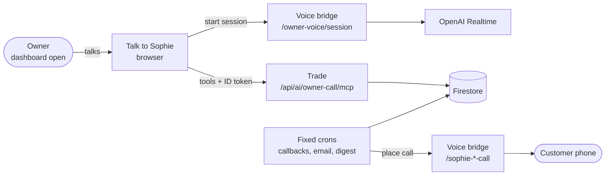

If the owner closes the dashboard, Talk to Sophie stops. Only the fixed crons keep running.

### 3.3 Target

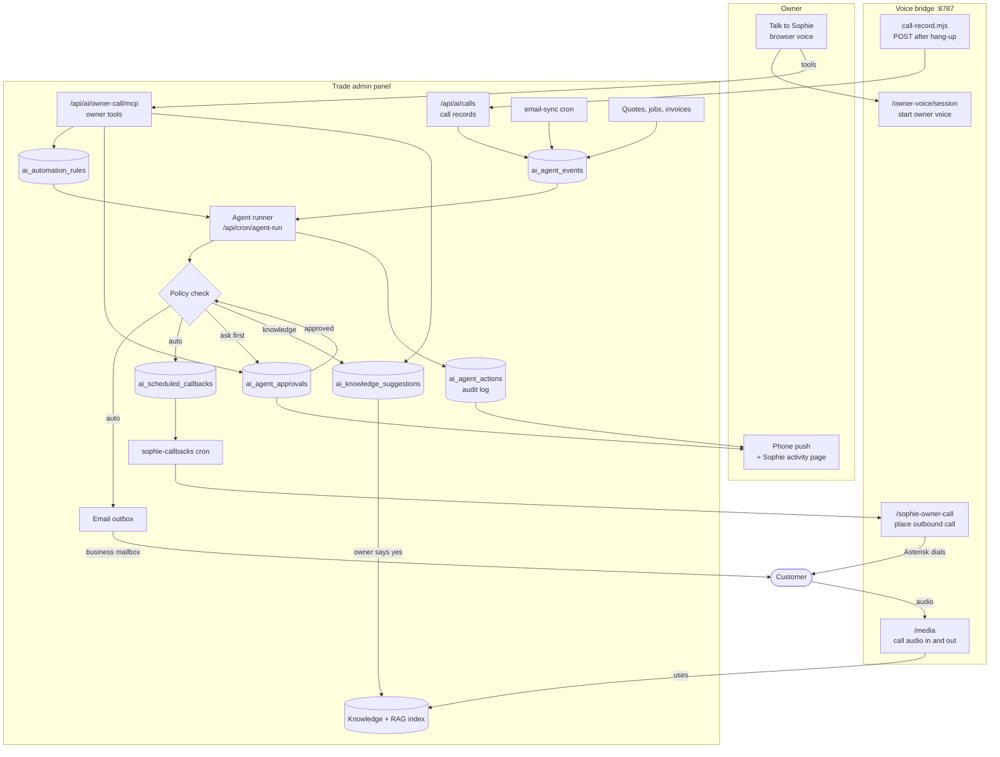

**How to read it:** events come in from the left (call ended, email arrived, quote unanswered). The runner checks the rules, and the policy check decides one of three things: do it now, ask the owner, or block it. Emails leave through the existing outbox. Calls leave through the existing scheduled-call worker and the bridge. Knowledge only ever becomes a **suggestion**, never a published fact, until the owner agrees.

### 3.4 The full loop in one line

```
event → runner → rule matches → AI writes text (if needed) → policy check
      → do it (email / call / suggestion)  or  ask owner  or  block
      → audit log → push / daily report → owner can pause at any time
```

---

## 4. Phase 0: the shared engine

Every feature uses these parts, so they are built first. Phase 0 sends **nothing**: it runs in **dry-run mode** and only logs what it *would* do.

### 4.1 Events (`ai_agent_events`)

An event is a short record that says "something happened":

```ts
type AgentEvent = {
  businessId: string;
  type:
    | "call.ended"            // bridge posted a call record
    | "email.received"        // a saved customer emailed the business
    | "email.sent_by_owner"   // the owner sent an email (not Sophie)
    | "quote.sent" | "quote.no_reply"
    | "job.tomorrow" | "job.completed"
    | "invoice.overdue"
    | "missed_call.unreached";
  entityId: string;           // call log id, email id, quote id ...
  status: "pending" | "processing" | "done" | "failed";
  leaseUntil?: number;        // for safe claiming
  createdAt: number;
};
```

- **The doc id is the dedupe key:** `${type}:${entityId}`. If the same event is written twice, only one exists.
- **Some events are written by existing code**, with one extra line each:
  - the call record route (`POST /api/ai/calls`) writes `call.ended`;
  - email sync writes `email.received` for a linked customer;
  - the outbox writes `email.sent_by_owner` when the owner sent the email.
- **Time events are found by a scan**, because "3 days with no reply" never happens as a single moment. The runner's scan step queries, for example, quotes with `status == "sent"` sent more than N days ago, and writes `quote.no_reply` with the dedupe key.

### 4.2 Rules (`ai_automation_rules`)

```ts
type AutomationRule = {
  businessId: string;
  trigger: AgentEvent["type"];
  delayDays?: number;               // e.g. 3 days after quote.sent
  action:
    | { kind: "send_email"; template: EmailTemplateId }
    | { kind: "schedule_call"; category: "service" | "quotation" | "invoice" | "other"; template: CallTemplateId }
    | { kind: "suggest_knowledge" }
    | { kind: "notify_owner" };
  level: "off" | "suggest" | "auto"; // see 4.5
  createdVia: "settings" | "owner_voice" | "default";
  paused: boolean;
  updatedAt: number;
};
```

Triggers and actions come from a **fixed list in code**. The owner picks from the list in Settings or by voice (Feature 4). Nothing outside the list can be created.

### 4.3 The agent runner

New file `lib/ai/agent/agent.ts` (it exists today but is empty). It is called from:

- the new cron `/api/cron/agent-run`, every 5 minutes, protected by `CRON_SECRET` like the other crons;
- `after()` right after an event is written, so most actions happen in seconds rather than minutes.

One run does the following:

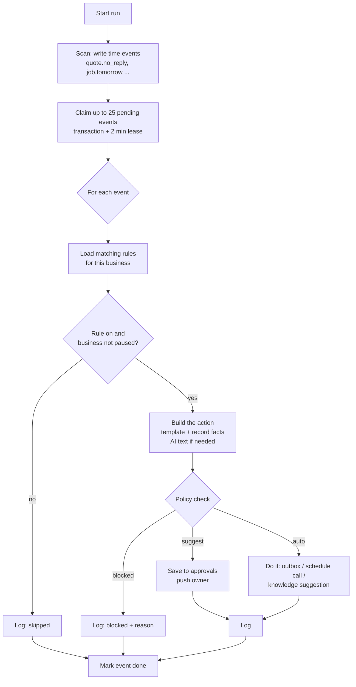

- **Time limit:** Vercel allows 60 seconds, so each run handles a batch. A lease that runs out lets the next run pick the event up again.
- **Local development:** Vercel crons do not run locally. Either add the runner to the dev poller (`lib/ai/calls/dev-callback-poller.ts`) or call the route with `curl` and the `CRON_SECRET`.

### 4.4 Server identity (no browser)

The owner MCP route **keeps** requiring the owner's ID token, and nothing about Talk to Sophie changes. The agent **never** uses that route. It calls Trade's own functions directly, as a fixed identity:

```ts
type AgentPrincipal = {
  kind: "agent";
  businessId: string;
  ownerUid: string;   // resolveBusinessOwnerUid(businessId)
  ruleId: string;
  eventId: string;
};
```

The agent's allowed actions, which form its whole tool list:

| Allowed | Never allowed |
|---|---|
| Read customers, quotes, jobs, invoices, emails, knowledge | Delete anything |
| Queue an email to a **saved customer** | Email an address that is not a saved customer |
| Schedule a Sophie call to a **saved customer** | Change prices, services, staff or leave |
| Save a **knowledge suggestion** | Publish knowledge |
| Create an approval request | Payments, refunds, discounts or promises |
| Push the owner | Accept or decline a quote for the customer |

### 4.5 Three levels for each rule

| Level | What happens | When to use it |
|---|---|---|
| `off` | Nothing | Default for every rule until the owner turns it on |
| `suggest` | Sophie prepares the email or call and **asks the owner**. Nothing is sent until approved | Default when a rule is first turned on. Required for anything AI-written |
| `auto` | Sophie does it, inside the limits | Only for **template** messages whose facts come straight from the record (dates, times, links) |

**Moving up a level:** when the owner has approved 10 of a rule's suggestions in a row without changing them, Sophie offers once: "You approved the last 10 quote reminders as written. Should I send them automatically from now on?"

### 4.6 The policy check (one function, every action)

New file `lib/ai/agent/policy.ts`. Every action, whether automatic or approved, passes it **at the moment of sending**, because things can change after a suggestion is made (the customer may reply or accept the quote).

| # | Check | Result if it fails |
|---|---|---|
| 1 | `AI_AGENT_ENABLED` on, and `AI_AGENT_DRY_RUN` off | Log only |
| 2 | Business has not paused Sophie automations | Blocked: `PAUSED` |
| 3 | Rule is on, at this level | Blocked: `RULE_OFF` |
| 4 | Target is a saved customer of **this** business, and the record version still matches | Blocked: `NOT_CUSTOMER` |
| 5 | Customer has not opted out (email or calls, per business) | Blocked: `OPTED_OUT` |
| 6 | **Stop conditions:** quote not yet accepted or rejected, customer has not replied since, job not cancelled | Blocked: `NO_LONGER_NEEDED` |
| 7 | Gap per customer: one automated contact per 48 hours | Held until later |
| 8 | Daily caps per business: 50 emails and 10 calls (settings can lower them) | Held until tomorrow |
| 9 | Hours: emails 7 am–8 pm, calls inside Sophie's calling hours, both in the business time zone | Held until the window opens |
| 10 | Dedupe key `agent:${ruleId}:${entityId}:${step}` is not already used | Skipped |
| 11 | Content scan: no card numbers, passwords or AI-like instructions in the text | Blocked, or turned into a suggestion |

### 4.7 Audit log and kill switches

- **`ai_agent_actions`** has one row per decision: event, rule, action, customer, status (`done`, `suggested`, `blocked`, `held`, `failed`, `dry_run`), reason code, and a short preview (subject plus the first 200 characters). Rows are kept for 180 days.
- **Dashboard → AI → Activity** is a new page that lists these rows, with filters and a **Pause all automations** button.
- **By voice:** "Sophie, stop all automations." Pausing only stops things, so it needs **no** confirmation. Resuming needs the normal read-back and yes.
- **Platform switch:** `AI_AGENT_ENABLED=false` stops the runner for every business at once.

### 4.8 Where the AI writes text

New file `lib/ai/agent/writer.ts` handles the AI text jobs. Each job is a single request with a JSON schema answer and **no tools**:

| Job | Input | Output |
|---|---|---|
| Write an email | Template, record facts, published knowledge passages | `{subject, body}` |
| Sort an incoming email | Sender, subject, first 2,000 characters | `{kind: question/booking/complaint/other, needsOwner}` |
| Find knowledge in text | The owner's sent email, or a call's questions | `{candidates: [{kind, title, body}]}` |
| Sum up an outbound call | The call log | `{reached, rightPerson, outcome, needsOwner, summary}` (reuses `lib/ai/calls/summarize.ts`) |

Text from emails and calls is **untrusted**. It is passed as data inside clear markers, and the writer never follows instructions found in it. The answer must match the schema or it is thrown away.

**The most important rule:** **automatic** messages are **templates**. Every number, date, price and link in them comes from the Firestore record, never from the AI. AI-written wording is only allowed at the `suggest` level, where the owner reads it first.

---

## 5. Feature 1: Sophie notices knowledge and adds it to RAG

### 5.1 What the owner experiences

> **Owner:** "Book John for Tuesday. Oh, and we don't do gas fitting anymore, we stopped last month."
> **Sophie:** *(does the booking, and quietly notes the gas fitting fact)*
> ... later ...
> **Owner:** "OK, that's all."
> **Sophie:** "Before you go: I noted one thing for my knowledge. 'We no longer offer gas fitting.' Should I add it as a draft?"
> **Owner:** "Yes."
> **Sophie:** "Saved as a draft. Publish it on the AI knowledge page when you're ready."

If the new fact **conflicts** with what she already knows:

> **Sophie:** "My knowledge says the call-out fee is $80, but you just said $90. Should I update that entry?"

### 5.2 Three sources of knowledge

| Source | How Sophie finds it | Who is trusted |
|---|---|---|
| **A. The owner talking to Sophie** | The realtime model notices a lasting business fact during the conversation and calls `note_knowledge_candidate` | The owner, with read-back |
| **B. Emails the owner sends** | Event `email.sent_by_owner`. The writer pulls out **general** facts ("our warranty is 12 months"), never customer-specific ones | The owner wrote it, but the owner still approves |
| **C. Customer calls** | Event `call.ended`. The runner groups the questions Sophie couldn't answer and the ones she handed to a person. It fills the empty `lib/ai/learning/suggest-from-handoff.ts` | Customers are **not** trusted. Only their **questions** are used, never their claims as facts |

Everything goes into **`ai_knowledge_suggestions`**. Nothing reaches callers until the owner saves the draft **and** publishes it. This keeps today's rule: "voice can mishear numbers, so the owner publishes."

### 5.3 How it works with the voice bridge (source A)

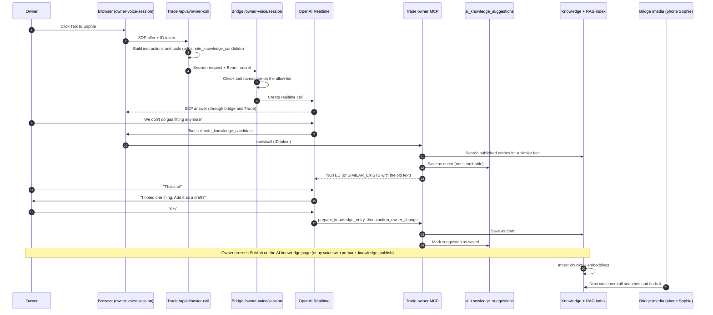

**Points to note:**

- **The bridge's only job here** is to start the session and allow the new tool name. The tool runs on Trade.
- **No transcript is stored.** The realtime model spots the fact itself, so the promise "the transcript is not saved" still holds.
- **Nothing is lost.** If the session ends first (the 10-minute limit, or the owner closes the tab), the noted facts wait in a **"Suggested by Sophie"** list on the AI knowledge page, with **Save as draft** and **Dismiss** buttons.

### 5.4 How sources B and C work (no voice bridge in the loop until the answer)

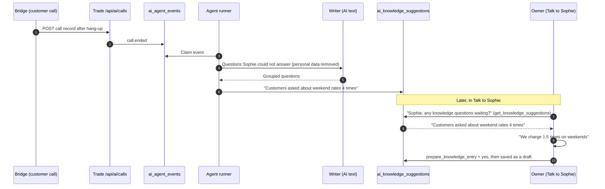

Here the **owner** gives the answer by voice, so it is trusted. The customers only provided the question.

### 5.5 New owner tools

| Tool | Arguments | Confirmation | Result |
|---|---|---|---|
| `note_knowledge_candidate` | `kind` (faq, policy or note), `title`, `body` (max 600 characters) | **None.** It saves nothing searchable | `NOTED`, `SIMILAR_EXISTS {entryId, text}`, `LIMIT_REACHED` (max 5 per session) |
| `get_knowledge_suggestions` | `limit` (max 5) | None (read only) | List with source, text and count |
| `dismiss_knowledge_suggestion` | `id` | None (it only hides) | `DISMISSED` |

Saving, updating and publishing use the **existing** tools: `prepare_knowledge_entry`, `prepare_knowledge_update`, `prepare_knowledge_publish` and `confirm_owner_change`.

**Instructions:** one line is added (about 220 characters). It must keep the session under the bridge's **4,000-character** limit. The longer rules go in the tool description, which doesn't count toward that limit.

> If the owner states a lasting business fact (price, area, hours, policy, warranty), call note_knowledge_candidate quietly. Before ending, offer to save noted facts as drafts.

### 5.6 Guardrails

- **Never published automatically.** Suggestions go to drafts, and drafts are published by the owner.
- **No customer details.** The existing `redact.ts` and `scanKnowledgeText()` run on every suggestion. If something is flagged, the suggestion is marked `needs_review`.
- **At most 5 notes per session and 20 suggestions per business per day.** Duplicates are merged and their count goes up.
- **A conflict is never fixed silently.** Sophie reads the old text and the new text and asks.
- **Customer claims are never knowledge.** From calls, only questions are kept.

### 5.7 Steps

1. Add `ai_knowledge_suggestions` with a type, helpers and a Firestore index (`lib/ai/learning/suggestions.ts`).
2. Add the three tools to `lib/ai/owner-call/owner-knowledge.ts` and `owner-actions.ts`, register runners in `lib/ai/owner-call/tools.ts`, and add the MCP handlers in `lib/ai/mcp/tools/owner-actions.tools.ts`.
3. Similar-fact check: call `searchPassages` from `lib/ai/rag/retriever.ts` against published entries. A top score at or above the threshold returns `SIMILAR_EXISTS`.
4. Add the instruction line in `app/api/ai/owner-call/route.ts`, then run the instruction-length test.
5. Add the three tool names to the bridge allow-list (section 10), then restart the bridge.
6. Add the "Suggested by Sophie" list to `components/ai-knowledge-board.tsx`.
7. Source B: write `email.sent_by_owner` in the outbox and add a writer job.
8. Source C: write `call.ended` in `POST /api/ai/calls`, and fill `suggest-from-handoff.ts`.
9. Flag: `AI_AGENT_KNOWLEDGE_CAPTURE_ENABLED`.

---

## 6. Feature 2: Automated email

### 6.1 The email list

| # | Trigger | What is sent | Made from | Default level |
|---|---|---|---|---|
| E1 | Sophie's customer call ended **with a booking or inspection created** | Confirmation: date, time window, address, what to expect | Template + job record | `auto` once turned on |
| E2 | Sophie's call ended and she **promised to send information** | The information, from **published** knowledge only | AI wording + RAG passages | `suggest` |
| E3 | Quote `sent`, no accept, reject or reply after 3 days | Friendly reminder with the quote link | Template + quote record | `suggest`, then `auto` |
| E4 | Job is tomorrow | Reminder with the time window and access notes | Template + job record | `auto` |
| E5 | Job completed | Thank you, plus the invoice link and a review link | Template | `suggest` |
| E6 | Invoice overdue (only if the overdue-invoices cron does not already email) | Payment reminder with the invoice link | Template + invoice record | `suggest` |
| E7 | A **saved customer** emails the business | Draft reply based on published knowledge | AI wording + RAG passages | **`suggest` only** (never `auto` in version 1) |
| E8 | Missed call, and Sophie's callback failed twice | "We tried to reach you" plus booking options | Template | `auto` |
| — | Owner digest every 30 minutes | Already built | — | — |

Every email:

- is sent from the **business's own connected mailbox** through `enqueueMailboxMessage`, so it appears in the business's Sent folder and the customer can reply;
- has an idempotency key `agent:${ruleId}:${entityId}:${step}`, so a retry never sends twice;
- ends with one line: "Sent by Sophie, the assistant for {Business}." followed by an opt-out line;
- is retried by the existing `/api/cron/email-outbox`.

### 6.2 How it works with the voice bridge: confirmation after a call (E1)

The bridge handles the call. Trade sends the email once the call record arrives.

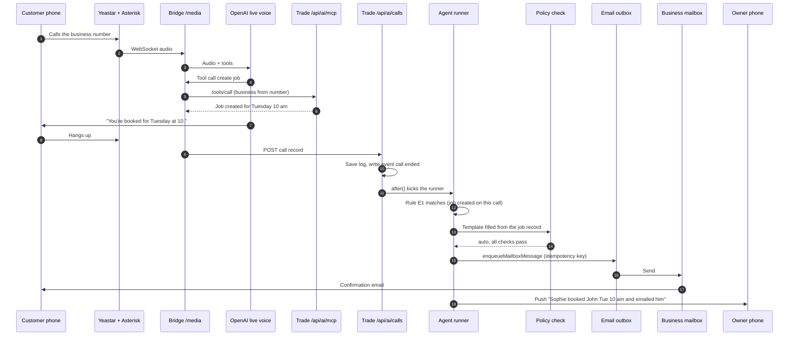

### 6.3 How it works: a customer emails the business (E7)

The bridge is not involved unless the owner approves **by voice**.

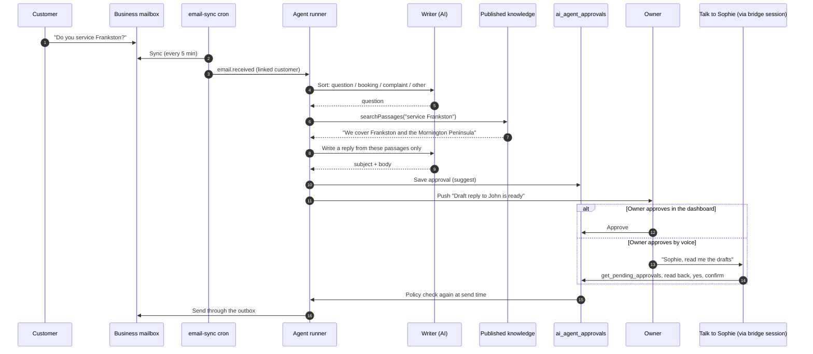

**Rules for incoming email:**

- **Complaints** and anything about money (refund, discount, dispute) are never drafted. The owner gets a push instead.
- If the knowledge has **no matching passage**, Sophie does not guess. She pushes the owner: "John asked something I don't know."
- Emails from people who are not saved customers are only counted in the digest. No reply is drafted.

### 6.4 Guardrails

- **Auto emails are templates.** No AI-invented prices or dates.
- **Recipients come from the customer record,** never from text inside an email.
- **Caps:** 50 per business per day, one automated contact per customer per 48 hours, and nothing between 8 pm and 7 am.
- **Opt-out:** a new `emailOptOut` field on the customer, set from the opt-out link or by the owner.
- **Stop conditions** are checked again at send time (section 4.6, check 6).
- **The existing 10-voice-emails-per-hour limit stays** for emails the owner sends by voice. Agent emails have their own caps.

### 6.5 Steps

1. Templates: `lib/ai/agent/templates/email/*.ts`. Each is a pure function from the record to `{subject, body}`, with unit tests.
2. Event writes: `call.ended` (call record route), `email.received` (sync), `quote.sent` and `job.completed` (their status-change code), plus the `quote.no_reply` and `job.tomorrow` scans.
3. Rules E1–E8 as **default rules** with level `off`, created the first time a business opens Settings → Sophie → Automations.
4. Runner action `send_email`, which goes through the policy check, then `enqueueMailboxMessage`.
5. Approvals for the `suggest` level (Feature 5).
6. Opt-out: a customer field plus a signed link route `app/api/email/opt-out/route.ts`.
7. Flags: `AI_AGENT_EMAIL_ENABLED`, plus `AI_AGENT_EMAIL_AUTO_ENABLED` to allow the `auto` level, plus `AI_AGENT_INBOUND_EMAIL_ENABLED` for E7.

---

## 7. Feature 3: Sophie calls customers by herself

### 7.1 The call list

| # | Trigger | What Sophie asks | Call category | Default level |
|---|---|---|---|---|
| C1 | Quote still has no answer 5 days after reminder E3 | "Did you get the quote? Any questions? Should the owner call you?" | `quotation` | `suggest` |
| C2 | Job tomorrow, customer has not confirmed | Confirm the time, access, pets and parking | `service` | `auto` |
| C3 | Job completed 2 days ago | "Are you happy with the work? Anything still to fix?" | `service` | `suggest` |
| C4 | Invoice overdue | Already built (overdue invoice calls) | `invoice` | Existing switches |
| C5 | Missed call | Already built (missed-call retry) | — | Existing switches |
| C6 | The owner says "call John on Monday" | Already built (owner-requested call) | Any | Owner confirms |

### 7.2 Reusing what already works

The bridge can already place an **owner-requested** call with a category and instructions. This feature uses that path, so **no new bridge endpoint is needed**:

- The agent writes an `ai_scheduled_callbacks` doc with `purpose: "owner_requested"`, the category, the instructions **from a call template**, and new fields `requestedBy: "agent"`, `ruleId` and `eventId`.
- The existing worker (`runScheduledSophieCallbacks`) already checks:
  - business route, owner and customer membership, name and phone;
  - opt-out, feature flags, calling hours and expiry;
  - a transactional claim so the call is placed only once.
- The bridge's `trade-owner-requested-call.mjs` already runs a **focused** call:
  - Sophie introduces herself and checks it is the right person before giving details;
  - she says nothing private to a voicemail or the wrong person;
  - she has no booking, payment or record-change tools;
  - she has callback and opt-out tools.

### 7.3 How it works with the voice bridge: quote follow-up call (C1)

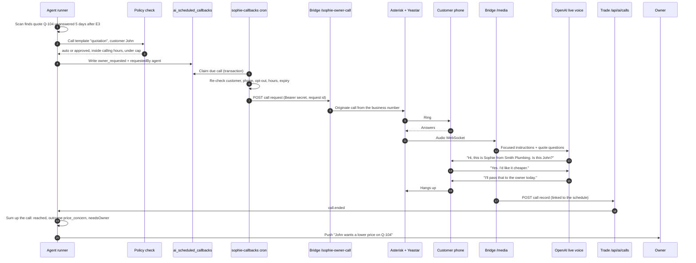

### 7.4 One customer, the whole chain

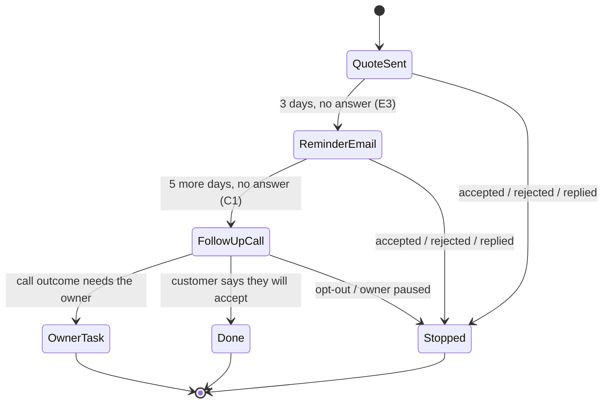

Every arrow passes the policy check again. Sophie **never** marks a quote as accepted herself. "I'll accept it" is a customer statement for the owner to act on.

### 7.5 Guardrails

- **All the existing call safeguards apply** (see `docs/sophie-call-safety.md` and `docs/owner-scheduled-calls.md`).
- **New caps:** 10 agent calls per business per day, one at a time per business, and one automated contact per customer per 48 hours across email **and** calls.
- **Complaints are never called automatically.** Category `complaint` is not allowed for `requestedBy: "agent"`.
- **Instructions come from templates.** The only fill-ins are record facts (quote number, job date). The worker's existing length and content checks still apply.
- **Calls wait while the bridge is busy.** The worker already defers a call when the bridge is full, so customer calls coming in always come first.
- **No re-dial loop.** An unclear result (no answer, voicemail) is not called again automatically. At most, E8-style email follows.

### 7.6 Steps

1. Call templates: `lib/ai/agent/templates/call/*.ts`, which build the category and instructions from the record.
2. Runner action `schedule_call` writes `ai_scheduled_callbacks` through the same helper the owner tool uses (`lib/ai/owner-call/owner-scheduled-calls.ts`), with `requestedBy: "agent"`.
3. Worker: allow `requestedBy: "agent"`, refuse `category: "complaint"` for it, and apply the agent caps.
4. Bridge (optional and small): carry `requestedBy` and `ruleId` into the call record so reports can show "Sophie's own call".
5. After the call: use `call.ended`, then the writer's "sum up an outbound call" job, then the next rule step or an owner push.
6. Flags: `AI_AGENT_CALLS_ENABLED`, which **also** requires the existing `AI_SOPHIE_CALLBACK_ENABLED=true` and `AI_OWNER_VOICE_SCHEDULED_CALLS_ENABLED=true`.

---

## 8. Feature 4: The owner sets rules by voice

### 8.1 Example

> **Owner:** "From now on, if a customer doesn't answer a quote in three days, send them a reminder."
> **Sophie:** *(prepare_automation_rule)* "Here's the rule: three days after a quote is sent with no answer, I write a reminder email. Should I ask you before each one, or send them automatically?"
> **Owner:** "Ask me first."
> **Sophie:** "Three days, reminder email, ask you first. Save it?"
> **Owner:** "Yes."
> **Sophie:** *(confirm_owner_change)* "Saved. You'll get a push when the first one is ready."

If the request is not on the list: "I can't do that one yet. I can do quote reminders, job reminders, after-job check-ins and follow-up calls."

### 8.2 How it works with the voice bridge

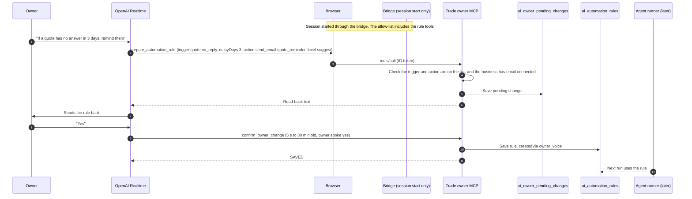

### 8.3 Tools

| Tool | What it does | Confirmation |
|---|---|---|
| `get_automations` | Lists rules, their levels and the last 7 days of counts | None (read only) |
| `prepare_automation_rule` | Adds a rule from the fixed list | Read-back, then yes, then `confirm_owner_change` |
| `prepare_automation_change` | Changes the level (off, suggest or auto), the delay, or resumes a rule | Read-back, then yes, then confirm |
| `pause_automations` | Pauses **all** rules for this business at once | **None.** It only stops things |

### 8.4 Steps

1. Add `lib/ai/owner-call/owner-automations.ts`, holding the trigger and action list, validation and read-back text.
2. Add the tools in `owner-actions.ts` and `tools.ts`, and the MCP handlers.
3. Add the API route `app/api/ai/automations/route.ts`. The Settings page and the MCP handler share it.
4. Build the Settings → Sophie → Automations page: rules list, levels, caps, quiet hours and the pause switch.
5. Add the four tool names to the bridge allow-list.
6. Flag: `AI_OWNER_VOICE_AUTOMATIONS_ENABLED`.

---

## 9. Feature 5: Sophie reports back and asks for approval

### 9.1 How the owner hears from Sophie

| What | How | When |
|---|---|---|
| An approval is waiting | Push "3 drafts waiting for your OK" | Batched every 30 minutes (alongside the email digest cron) |
| Something important | Push straight away | Complaint email, price concern on a call, a failed send |
| Daily report | Push "Today: 6 emails sent, 2 calls, 1 waiting for you" | Once a day, at a time the owner picks (default 6 pm) |
| Full list | Dashboard → AI → Activity | At any time |
| By voice | "Sophie, what did you do today?" | At any time in Talk to Sophie |

### 9.2 Approvals (`ai_agent_approvals`)

- Each approval holds the **exact** email or call that will happen, along with a preview.
- **Approve** runs the policy check again and then sends. **Reject** drops it. **Edit** (dashboard only) changes the text and then sends.
- Approvals **expire after 48 hours**. An old reminder is worse than none.
- **By voice, approvals are one at a time.** Sophie reads the recipient, the subject and a short summary, then waits for a yes. There is no "approve all" by voice.

### 9.3 How it works with the voice bridge

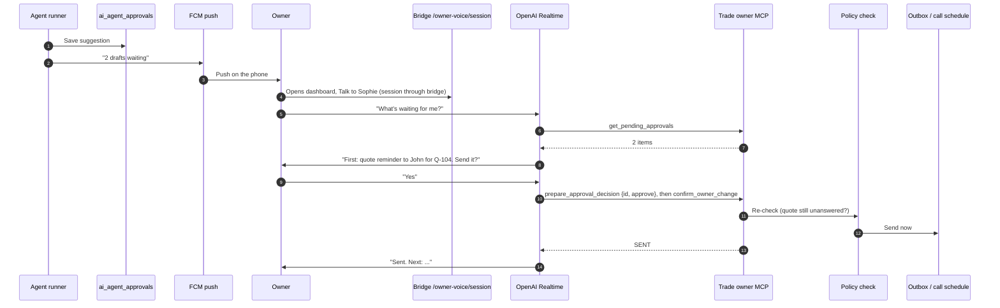

### 9.4 Tools

| Tool | Confirmation |
|---|---|
| `get_agent_activity {date}` | None (read only) |
| `get_pending_approvals` | None (read only) |
| `prepare_approval_decision {approvalId, decision}` | Read-back, then yes, then `confirm_owner_change` |

### 9.5 Later option: Sophie phones the owner

For urgent items when the owner isn't looking at the phone, Sophie could **call the owner** through the bridge, just as she calls customers. That needs a new call type in the bridge (`owner_briefing`), plus a way to prove it is the owner on the line (a PIN). It is left for the last phase.

### 9.6 Steps

1. Add `ai_agent_approvals`, its helpers and index.
2. Add the API routes `app/api/ai/agent/approvals/route.ts` and `[id]/route.ts`.
3. Build the dashboard page `app/dashboard/ai/activity/page.tsx` (next to the existing `ai/calls`, `ai/knowledge` and `ai/unanswered`), with an approvals tab and an activity tab.
4. Push: batch with the digest cron and add a daily report cron `/api/cron/agent-daily-report`.
5. Add the voice tools and put their names on the bridge allow-list.

---

## 10. Voice bridge changes

**The bridge stays the voice and phone layer.** No business logic moves into it. Most phases only need new names on the allow-list.

| Change | File | Phase | Needed? |
|---|---|---|---|
| Add the owner tool names `note_knowledge_candidate`, `get_knowledge_suggestions` and `dismiss_knowledge_suggestion` | `src/agents/trade/trade-owner-voice.mjs` (`toolNames`) | 1 | Yes |
| Add `get_automations`, `prepare_automation_rule`, `prepare_automation_change` and `pause_automations` | same | 5 | Yes |
| Add `get_agent_activity`, `get_pending_approvals` and `prepare_approval_decision` | same | 2 | Yes |
| Carry `requestedBy` and `ruleId` on owner-requested calls into the call record | `src/agents/trade/trade-sophie-callback.mjs`, `src/observability/call-record.mjs` | 4 | Optional (for reports) |
| Opening-line variant for agent calls ("calling about your quote") | `src/agents/trade/trade-owner-requested-call.mjs` | 4 | Optional |
| Owner briefing call (Sophie phones the owner) | New `trade-owner-briefing-call.mjs` and a route in `src/server/bridge.mjs` | 7 | Later |

**Order of deployment:** deploy the bridge **first**, then turn on the Trade flag. Trade builds the tool list, and the bridge **rejects** any session that offers a name it doesn't know. Restart the bridge only when **no calls are active**.

**Instruction budget:** Trade builds the instructions, and the bridge caps them at **4,000 characters**. Each phase adds at most one short line. Detail goes in the tool descriptions. The existing test that checks the instruction length must stay green with every flag on and `AI_OWNER_VOICE_TOOL_MODE=both`.

---

## 11. Data model

All new collections are **Admin SDK only** in `firestore.rules`. The owner reaches them through authenticated API routes, as with `ai_scheduled_callbacks` today.

| Collection | Doc id | Main fields | Kept for | Index |
|---|---|---|---|---|
| `ai_agent_events` | `${type}:${entityId}` | businessId, type, entityId, status, leaseUntil, createdAt | 30 days | (status, createdAt) |
| `ai_automation_rules` | auto | businessId, trigger, delayDays, action, level, paused, createdVia, approvedInARow | Until deleted | (businessId, trigger) |
| `ai_agent_actions` | auto | businessId, eventId, ruleId, action, customerId, status, reason, preview, createdAt | 180 days | (businessId, createdAt desc), (businessId, status, createdAt desc) |
| `ai_agent_approvals` | auto | businessId, ruleId, action payload, preview, status, expiresAt, decidedBy, decidedVia | 30 days after decision | (businessId, status, createdAt desc) |
| `ai_knowledge_suggestions` | hash of normalised text | businessId, source (owner_voice, owner_email, calls), kind, title, body, count, status, similarEntryId | 90 days | (businessId, status, createdAt desc) |
| `ai_agent_state` | businessId | paused, todayEmails, todayCalls, dayKey, lastDailyReportAt | — | — |
| `customers` (existing) | — | **new:** `emailOptOut`, `lastAutomatedContactAt` | — | — |
| `ai_scheduled_callbacks` (existing) | — | **new:** `requestedBy`, `ruleId`, `eventId` | as today | — |

---

## 12. Settings and feature flags

### Trade `.env.local`

```env
# Master switch: nothing runs without it
AI_AGENT_ENABLED=false
# Log what would happen, but send nothing (keep true for the first week)
AI_AGENT_DRY_RUN=true
# Text model for writing emails, sorting email, finding knowledge
AI_AGENT_MODEL=gpt-4.1-mini

# Features
AI_AGENT_KNOWLEDGE_CAPTURE_ENABLED=false
AI_AGENT_EMAIL_ENABLED=false
AI_AGENT_EMAIL_AUTO_ENABLED=false      # allows level "auto" for template emails
AI_AGENT_INBOUND_EMAIL_ENABLED=false   # E7 draft replies
AI_AGENT_CALLS_ENABLED=false           # also needs AI_SOPHIE_CALLBACK_ENABLED and AI_OWNER_VOICE_SCHEDULED_CALLS_ENABLED
AI_OWNER_VOICE_AUTOMATIONS_ENABLED=false

# Platform caps (a business can set lower ones)
AI_AGENT_DAILY_EMAIL_CAP=50
AI_AGENT_DAILY_CALL_CAP=10
```

`AI_AGENT_MODEL` uses the same default as quotation drafts (`AI_QUOTATION_MODEL`, `gpt-4.1-mini` in `lib/ai/quotation/voice-draft.ts`).

### Business settings (Settings → Sophie → Automations)

- Automations on/off (the pause switch)
- Each rule: off, suggest or auto (auto only if the platform allows it)
- Daily caps (up to the platform caps)
- Email hours (default 7 am–8 pm)
- Daily report time (default 6 pm)
- Gap per customer (default 48 hours)

### Cron (`vercel.json`)

```json
{ "path": "/api/cron/agent-run", "schedule": "*/5 * * * *" },
{ "path": "/api/cron/agent-daily-report", "schedule": "0 * * * *" }
```

The daily report cron runs every hour and only sends to businesses whose chosen time has come, so each business gets its report in its own time zone.

---

## 13. Rollout plan, step by step

Each phase is switched on by its own flag and can be turned off without losing data.

### Phase 0: Engine in dry-run (sends nothing)

1. Types and helpers: `lib/ai/agent/types.ts` (events, rules, principal, actions).
2. Event writes in the call record route, email sync, outbox, and quote and job status changes.
3. Scans for `quote.no_reply`, `job.tomorrow` and `invoice.overdue`.
4. Runner `lib/ai/agent/agent.ts`, plus the cron `/api/cron/agent-run` and the `after()` kick.
5. Policy check `lib/ai/agent/policy.ts`, with all 11 checks.
6. Audit `ai_agent_actions` and a read-only **AI → Activity** page.
7. Pause switch: the business setting plus `pause_automations`.
8. Firestore rules and indexes. Deploy with `firebase deploy --only firestore:rules,firestore:indexes`.

**Done when:** a week of dry-run logs shows the right rules matching the right events, with no duplicates and no blocked reasons that look wrong.

### Phase 1: Knowledge capture (Feature 1)

1. `ai_knowledge_suggestions` and its helpers.
2. Tools `note_knowledge_candidate`, `get_knowledge_suggestions` and `dismiss_knowledge_suggestion`.
3. The similar-fact check with the retriever.
4. The instruction line, plus the length test.
5. Bridge allow-list, then restart the bridge.
6. The "Suggested by Sophie" list on the AI knowledge page.
7. Source B (owner's sent emails) and source C (call questions, `suggest-from-handoff.ts`).

**Done when:** a fact said in passing becomes a suggestion; "yes" makes it a draft; a conflict asks to update instead; a customer's claim never becomes knowledge.

### Phase 2: Email in suggest mode (Feature 2 + approvals from Feature 5)

1. Email templates E1–E8, with tests.
2. Runner action `send_email`.
3. Approvals collection, API, dashboard tab, push batching.
4. Voice tools `get_pending_approvals` and `prepare_approval_decision`, plus the bridge allow-list.
5. Opt-out field and link.
6. Turn off `AI_AGENT_DRY_RUN` for email only, with every rule at `suggest`.

**Done when:** the owner approves real drafts, and approved emails arrive once and only once, from the business mailbox.

### Phase 3: Email in auto mode

1. Allow `auto` for the template rules (E1, E4, E8) with `AI_AGENT_EMAIL_AUTO_ENABLED`.
2. The "approved 10 in a row" prompt to move a rule up.
3. Daily report push.

**Done when:** auto emails respect the caps, the quiet hours, the 48-hour gap and opt-out in tests and in a real week.

### Phase 4: Automated calls (Feature 3)

1. Call templates C1–C3.
2. Runner action `schedule_call`, which uses the existing owner-requested path.
3. Worker: accept `requestedBy: "agent"`, refuse `complaint`, apply the agent caps.
4. Bridge (optional): `requestedBy` in call records.
5. After-call summary leads to the next step or an owner push.
6. Test with the team's own phones as "customers" before any real customer.

**Done when:** a test quote moves through the whole chain (email, call, owner push), and every stop condition stops it.

### Phase 5: Rules by voice (Feature 4)

1. `owner-automations.ts`, the tools and the API route.
2. The Settings → Sophie → Automations page.
3. Bridge allow-list.

### Phase 6: Replies to incoming email (E7, suggest only)

1. The sorting job, plus RAG-only reply drafts.
2. Complaints and money questions go to an owner push only.

### Phase 7 (later): Sophie phones the owner

1. Bridge `owner_briefing` call type, with a PIN check.
2. Urgent items trigger a call when no push has been opened for 30 minutes.

---

## 14. Tests

Use the same style as today: `node:test` with fixtures, fake Firestore, fake dialling and mocked HTTP. **No real customer is called or emailed in tests.**

| File | What it checks |
|---|---|
| `scripts/test-agent-policy.ts` | Each of the 11 checks on its own: opt-out, paused, caps, hours, 48-hour gap, stop conditions, dedupe, not a customer, content scan |
| `scripts/test-agent-runner.ts` | Claim and lease (two runners never take the same event); a run that runs out of time leaves the event for the next run; dry-run writes logs only |
| `scripts/test-agent-email-templates.ts` | Every template only uses record facts; no empty fields; time zone; opt-out line |
| `scripts/test-agent-knowledge.ts` | Notes limit per session; similar-fact check; customer claims rejected; redaction |
| `scripts/test-agent-calls.ts` | Agent call uses owner_requested; complaint refused; caps; worker re-checks |
| `scripts/test-ai-owner-call.ts` (existing) | New tools appear only with their flags; instructions stay under 4,000 characters with every flag on and mode `both`; no duplicate tool names |
| Bridge `tests/owner-voice.test.mjs` (existing) | New names are accepted; an unknown name is still rejected |

**Manual checks before each phase goes live:**

1. Dry-run log: every matched rule is right, with no duplicates.
2. Turn the business pause on, and check that nothing goes out.
3. Opt a test customer out, and check the email and the call are both skipped.
4. Accept the quote after a reminder is drafted, and check that approving it now says "no longer needed".
5. Say "No, wait" to a voice approval, and check nothing is sent.
6. Check that existing missed-call, invoice-call and owner-requested calls still work.

---

## 15. Risks and decisions

### Risks

| Risk | What protects against it |
|---|---|
| A wrong price or date in an email | Auto emails are templates filled from records. AI wording needs approval |
| Too many messages to one customer | 48-hour gap across email and calls, daily caps, stop conditions, opt-out |
| An email or a caller tries to give Sophie instructions (prompt injection) | Their text is data only. The writer has no tools, and its answers must match a schema. Replies are never sent automatically |
| Wrong facts entering knowledge | Suggestions become drafts, and drafts are published by the owner. Customer claims are never used |
| Agent calls take the line when customers call in | The worker defers when the bridge is busy, and there is one agent call at a time per business |
| The bridge is down | Emails and knowledge still work. Calls wait and expire as they do today |
| Cost | Triggers are plain code. The AI only runs for text jobs, so roughly one small request per action |
| Owner loses trust | Activity log, daily report, one-sentence pause, and dry-run first |
| Law on automated contact | In Australia, the Spam Act 2003 (consent and unsubscribe for commercial email) and the Do Not Call Register rules for sales calls may apply. Service messages to existing customers are treated differently from marketing. **Check with a legal adviser before turning on auto email or calls.** |

### Decisions for the owner

1. **The default level for new rules:** recommended `suggest`.
2. **The gap between automated contacts per customer:** recommended 48 hours.
3. **Signing automated emails as "Sophie, the assistant for {Business}":** recommended yes, because it is honest and lowers risk.
4. **The daily report time:** recommended 6 pm.
5. **Which rules to turn on first:** recommended E1 (booking confirmation) and E4 (job reminder). They use only record facts and customers expect them.

### Related docs

- `docs/sophie-automation-catalogue.md`: 38 more automations with diagrams, plus the full folder structure for this plan and the catalogue
- `docs/SOPHIE_AI_AGENT_GUIDE.md`: the whole system, ports and the voice bridge
- `docs/owner-voice-mcp-and-browser.md`: browser tools and MCP tools
- `docs/owner-voice-email.md`: email by voice, counts and the digest
- `docs/owner-voice-knowledge-plan.md` and `docs/RAG_HOW_IT_WORKS.md`: knowledge and RAG
- `docs/owner-scheduled-calls.md` and `docs/sophie-call-safety.md`: outbound calls and their safeguards
